# Установка сторонних приложений на ГУ с прошивкой GWM-club

На прошивке GWM-club APK ставится прямо на ГУ. Смартфон передаёт файл по Wi-Fi, а установщик
запускается в файловом менеджере. Кабель, инженерное меню и компьютер не нужны.

Понадобятся:
- ГУ с прошивкой GWM-club и приложение
  [Файловый менеджер +](https://play.google.com/store/apps/details?id=com.alphainventor.filemanager).
  На ГУ его ставят из штатного приложения «Приложения»;
- смартфон на Android с тем же приложением, которое ставится из Google Play по этой же ссылке;
- одна сеть для ГУ и смартфона: либо оба подключены к одному Wi-Fi, либо ГУ подключён к точке
  доступа на смартфоне.

## 1. Скачать APK на смартфон

Откройте на смартфоне [страницу витрины](https://github.com/theKomix/gwm-apps), выберите нужное
приложение и скачайте APK актуальной версии из раздела «Версии» на его странице.

## 2. Запустить FTP-сервер на ГУ

1. Откройте на ГУ штатное приложение «Приложения» и установите «Файловый менеджер +». Запустите
   его: при первом запуске нажмите «Далее» и разрешите доступ к файлам.

   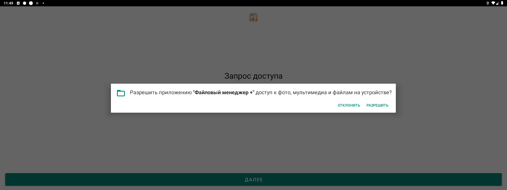

2. Откройте «Доступ из сети» и нажмите «Пуск».

   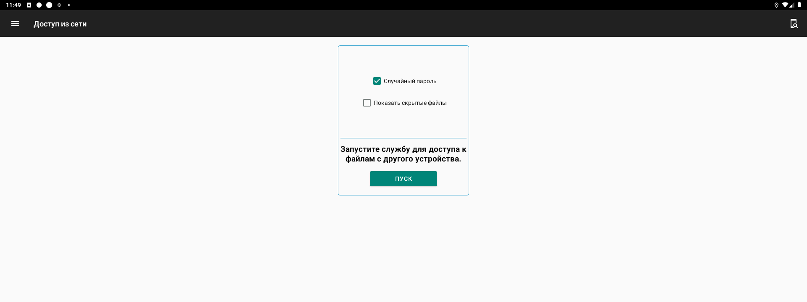

3. Приложение покажет адрес вида `ftp://…`, имя пользователя и пароль. Пароль каждый раз новый.
   Эти данные понадобятся на смартфоне.

   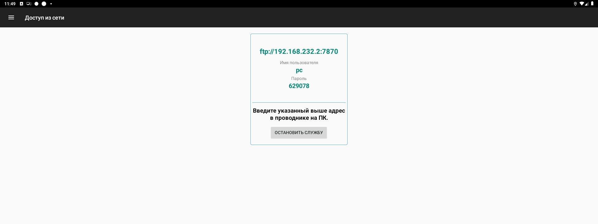

## 3. Передать APK со смартфона

1. Подключите ГУ и смартфон к одной сети: к одному Wi-Fi или включите на смартфоне точку доступа
   и подключите к ней ГУ.
2. Откройте на смартфоне «Файловый менеджер +», перейдите в «Удалённые службы» и нажмите
   «Добавить удалённое место» → «FTP».

   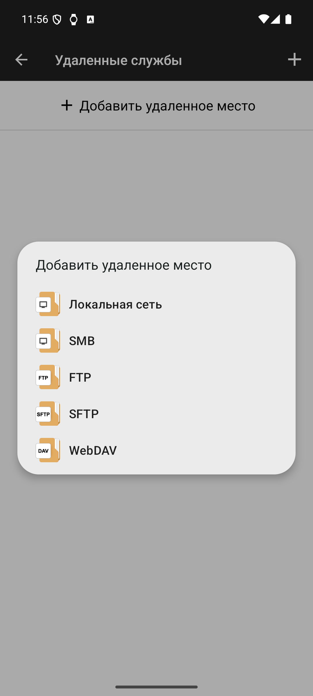

3. В поле «Хост» введите IP-адрес с экрана ГУ, в поле «Порт» — число после двоеточия, затем имя
   пользователя и пароль. Вместо «FTPS», которое выбрано по умолчанию, отметьте «FTP»: сервер
   на ГУ работает без шифрования. Нажмите «ОК».

   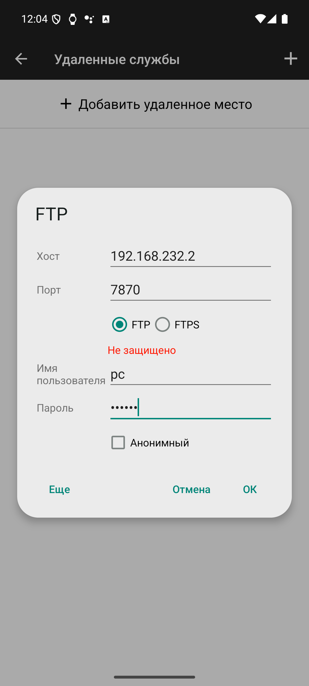

4. Откройте на смартфоне папку с APK, нажмите на файл и держите, пока он не выделится, затем
   нажмите «Копировать».

   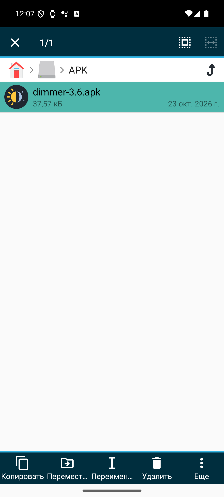

5. Вернитесь в «Удалённые службы», откройте добавленное место, затем `device` → `Download`
   и нажмите «Вставить». Папка `device` — это память ГУ.

   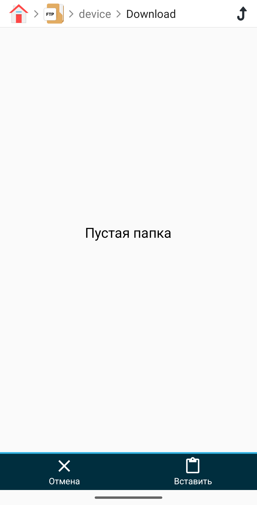

6. Когда файл появится в списке, передача закончена.

   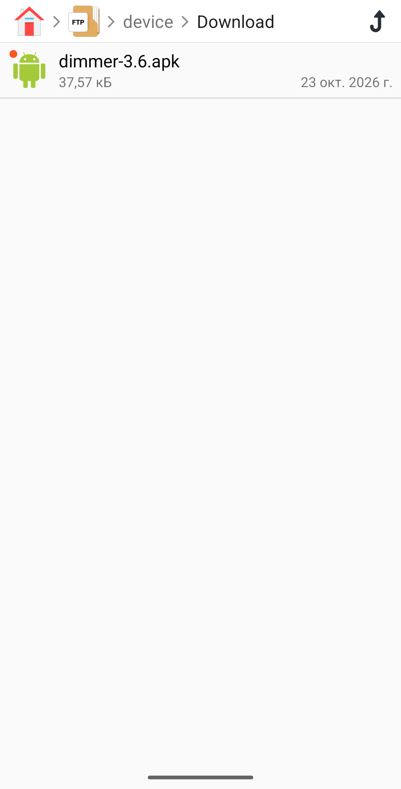

## 4. Установить APK

1. На ГУ откройте в «Файловом менеджере +» «Основная память» → `Download` и нажмите на APK.
   Приложение покажет его название и версию. Нажмите «Установить».

   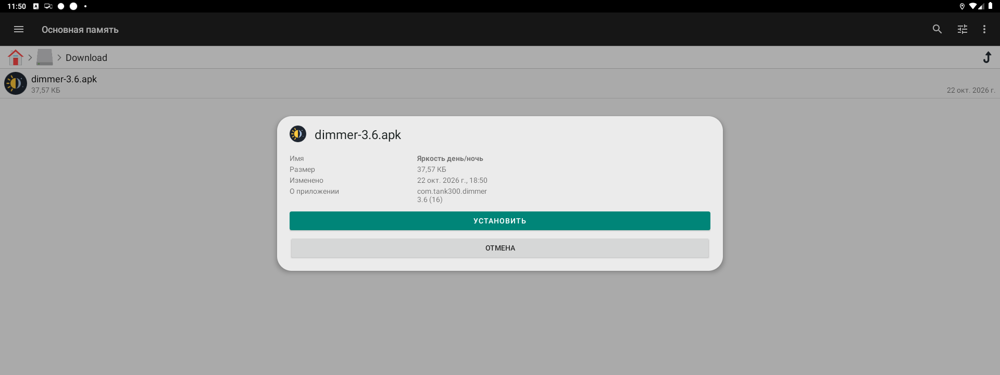

2. Если Android сообщит, что установка из неизвестных источников заблокирована, нажмите
   «Настройки» и включите «Разрешить установку из этого источника». Потом вернитесь назад
   кнопкой со стрелкой. Разрешение выдаётся один раз.

   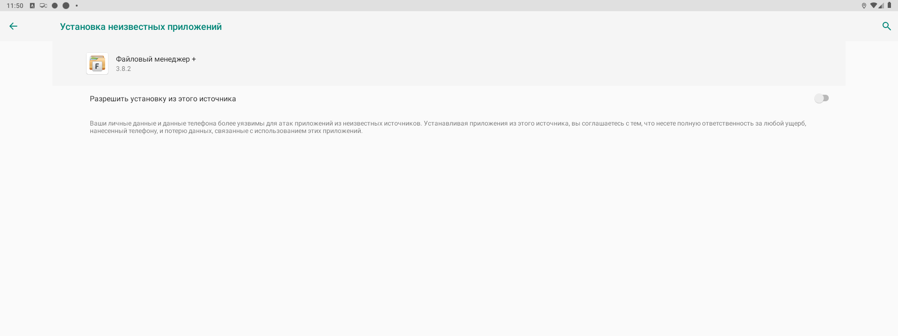

3. Подтвердите установку кнопкой «Установить». Когда появится «Приложение установлено»,
   нажмите «Готово».

   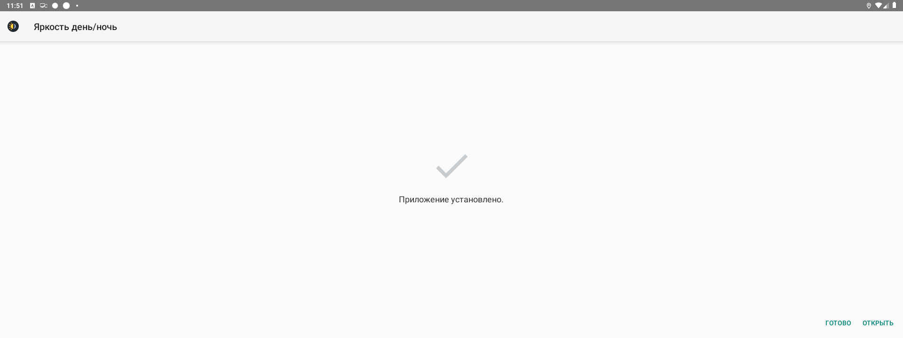

4. В «Файловом менеджере +» вернитесь в «Доступ из сети» и остановите службу.

## После установки

Приложение появится в общем списке. Откройте его и настройте. Дальше оно работает само.

Новая версия ставится тем же способом поверх старой, настройки сохраняются.
