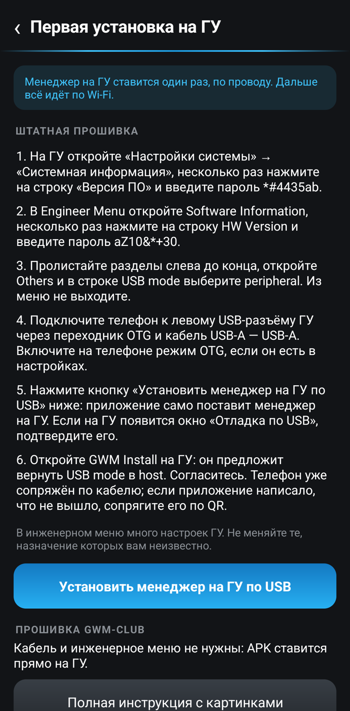
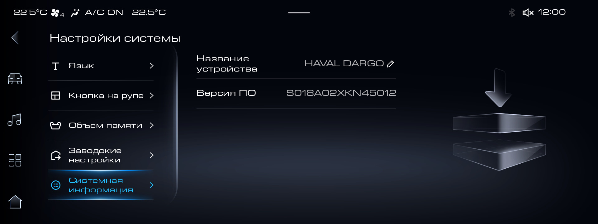
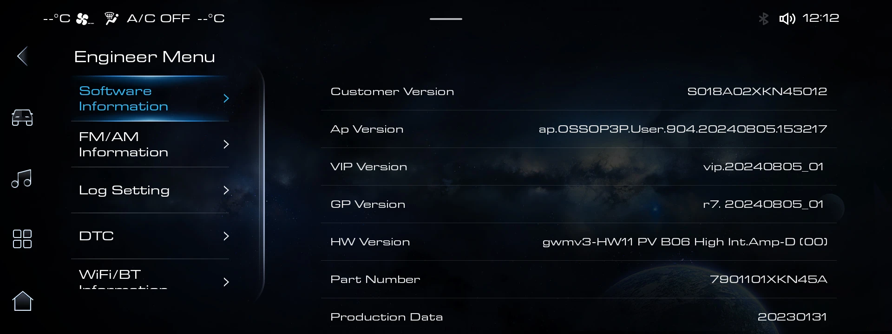
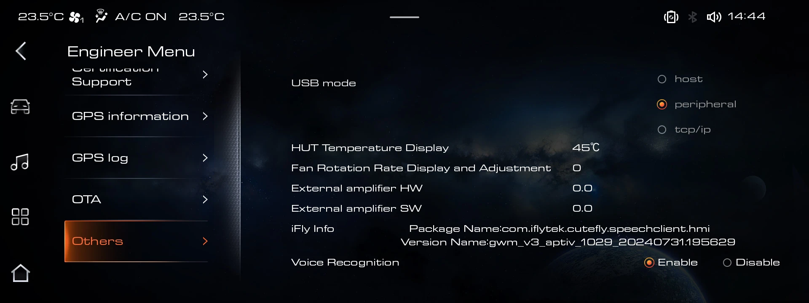

# Установка приложений на ГУ со штатной прошивкой

На штатной прошивке сторонние приложения ставит [GWM Install](gwm-install/README.md): с телефона по
Wi-Fi. Сам GWM Install на ГУ ставится один раз, проводом. Если у вас Android-телефон, это делает
его клиент. Без Android-телефона остаётся ноутбук с adb.

На прошивке GWM-club кабель и инженерное меню не нужны: APK ставится прямо на ГУ, см.
[инструкцию для GWM-club](INSTALL-CLUB.md).

## С Android-телефоном

1. Скачайте на телефон последнюю версию клиента `gwm-install-phone-…` из раздела «Версии» на
   [странице GWM Install](gwm-install/README.md) и установите её.
2. Подключите телефон к левому USB-разъёму ГУ проводом: через переходник OTG и кабель
   USB-A — USB-A.
3. Откройте в клиенте «Как поставить менеджер на ГУ». Подробная инструкция по шагам лежит в
   самом приложении: инженерное меню ГУ, режим USB, установка. Там же кнопка «Установить
   менеджер на ГУ по USB».

   

4. После установки откройте «GWM Install» на ГУ и согласитесь вернуть USB в режим Host. Телефон
   сопрягается с ГУ ещё по кабелю и позже находит его в сети: ГУ и телефон должны быть в одной
   сети Wi-Fi, например в точке доступа телефона. Если клиент написал, что сопряжение не вышло,
   сопрягите телефон по QR, как описано на [странице GWM Install](gwm-install/README.md). Дальше
   приложения ставятся с телефона по Wi-Fi, провод не нужен.

### Если антивирус ругается на клиент

Обычный клиент везёт с собой файл приёмника для ГУ. Антивирус «СберБанк Онлайн» ругался на такой APK внутри APK. Облегчённый клиент `gwm-install-lite-…` приёмника внутри не содержит: на него антивирус Сбера не ругался, на других антивирусах не проверялось. Пакет и подпись у него те же, что у обычного.

1. Поставьте на телефон `gwm-install-lite-…` вместо `gwm-install-phone-…`.
2. Скачайте на телефон `gwm-install-hu-…`. Это файл для ГУ, ставить его на телефоне не нужно. Кнопка «Открыть страницу GWM Install» в клиенте ведёт на страницу с файлами.
3. Выполните шаги 2 и 3 выше. Нажав «Установить менеджер на ГУ по USB», выберите скачанный `gwm-install-hu-…`. Клиент проверит, что это приёмник GWM Install с нужной подписью, чужой APK он отклонит.
4. Дальше как в шаге 4.

## Без Android-телефона: ноутбук с adb

Без Android-телефона приёмник на штатной прошивке ставится только так. Понадобятся ноутбук с
adb, кабель USB-A — USB-A и файл `gwm-install-hu-…` из раздела «Версии» на странице GWM Install.

1. Включите на ГУ USB mode `peripheral`:
   1. Откройте на ГУ «Настройки системы» → «Системная информация».
   2. Несколько раз нажмите на строку «Версия ПО» и введите первый пароль: `*#4435ab`.

      

   3. Откроется Engineer Menu. В разделе Software Information несколько раз нажмите на строку
      HW Version и введите второй пароль: `aZ10&*+30`.

      

   4. Пролистайте список разделов слева до конца, откройте Others и в строке USB mode выберите
      `peripheral`. Из инженерного меню не выходите.

      

   В инженерном меню много настроек ГУ. Не меняйте те, назначение которых вам неизвестно.
2. Подключите ноутбук к левому USB-разъёму ГУ и проверьте, что `adb devices` показывает ГУ.
3. Поставьте приёмник: `adb install -r gwm-install-hu-….apk`.
4. Откройте «GWM Install» на ГУ и согласитесь вернуть USB в режим Host. Дальше приложения
   ставятся с телефона по Wi-Fi: [описание GWM Install](gwm-install/README.md).

В инструкции использован материал из [поста на Drive2](https://www.drive2.ru/l/736193954369785708/).
