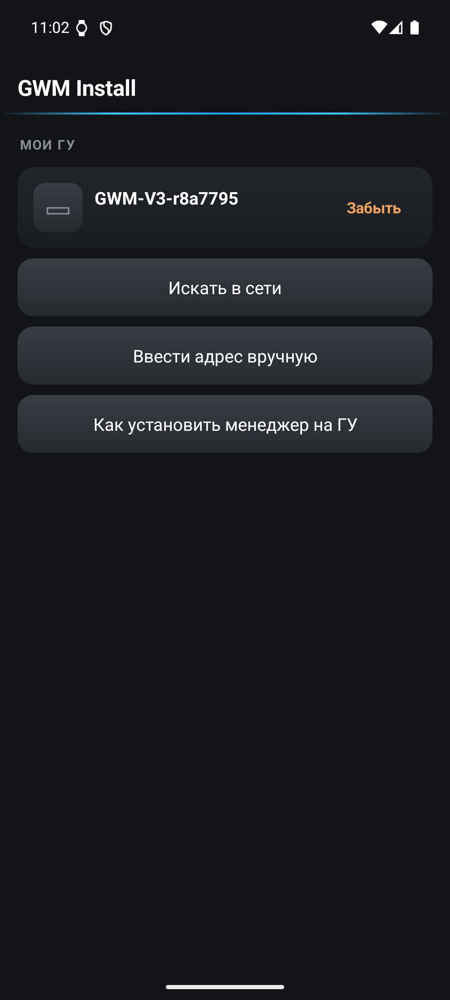
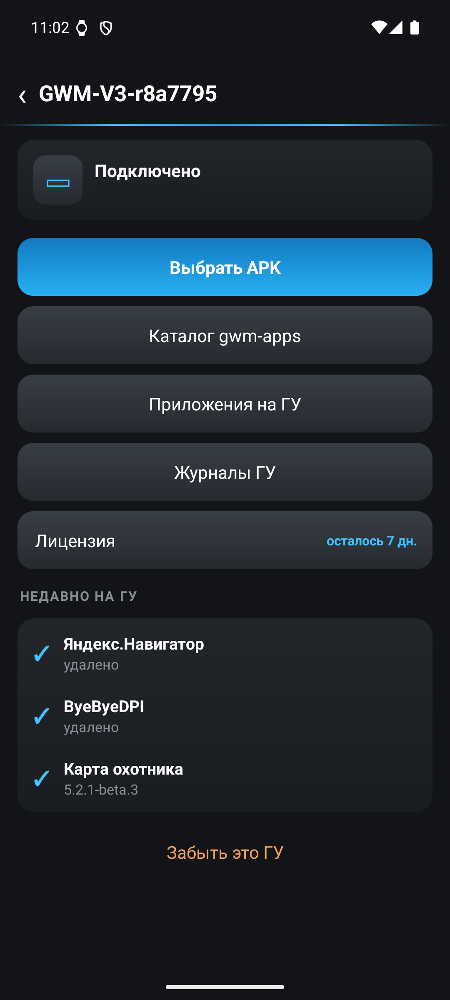
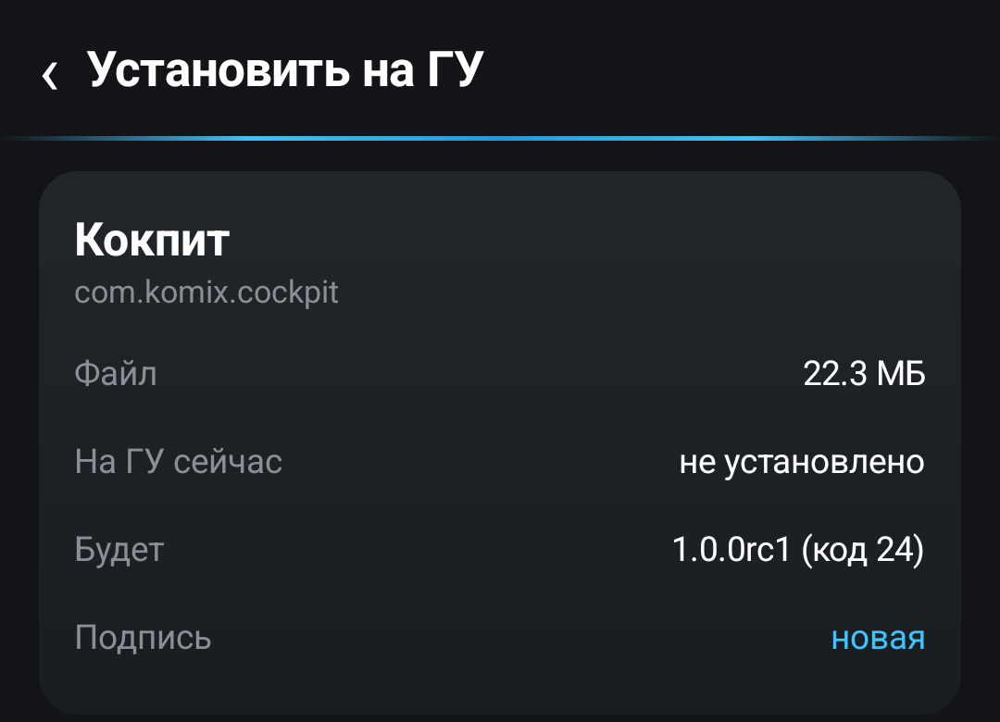
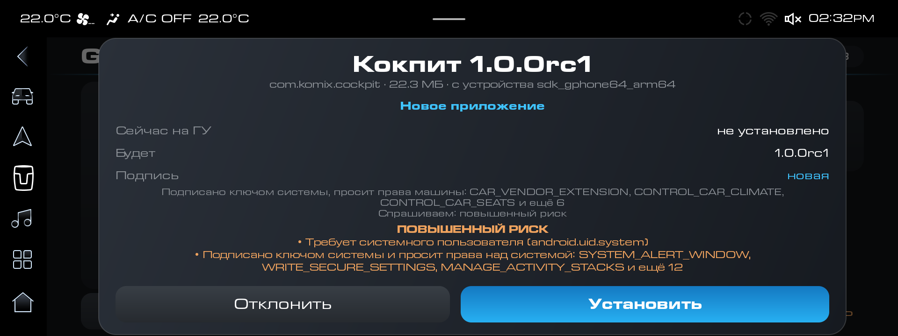
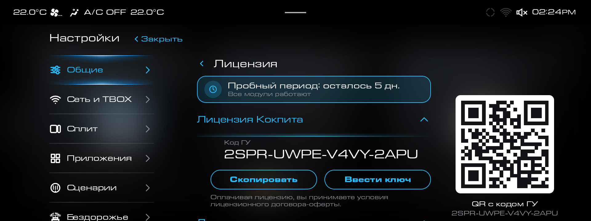
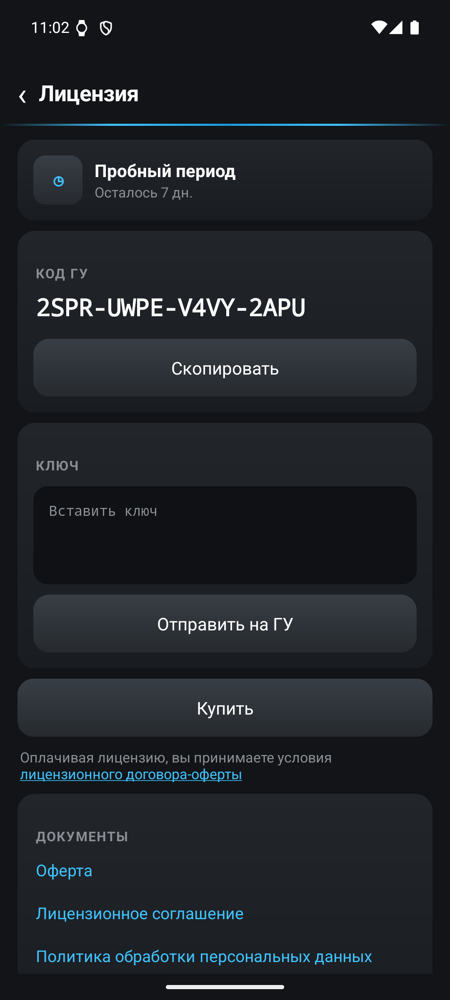
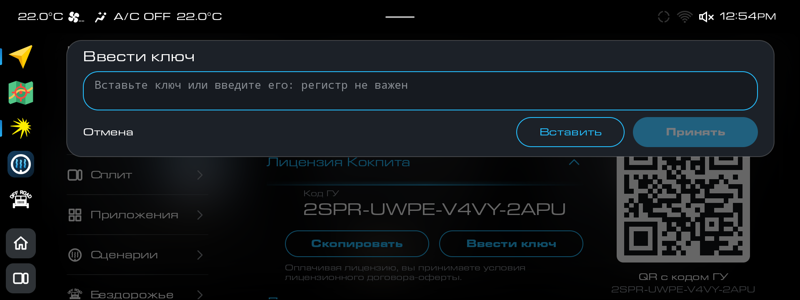
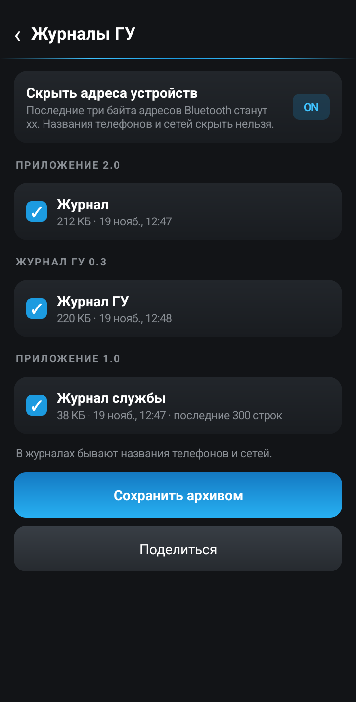
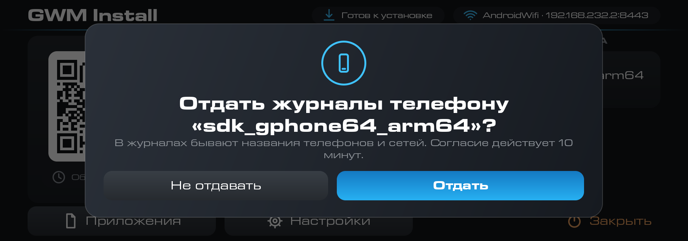
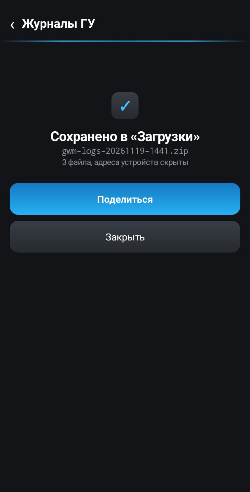

# Кокпит: установка и лицензия

Кокпит ставится на ГУ с телефона через GWM Install. Здесь установка облегчённым клиентом `gwm-install-lite`, потом получение кода ГУ, покупка и ввод ключа. Первые 7 дней Кокпит работает целиком без оплаты. Дальше платные модули нужно открыть ключом: одна лицензия на одно ГУ.

## Что понадобится

- ГУ Tank 300 или другое ГУ GWM на платформе Aptiv с Android 9.
- Телефон: Android 10 или новее (клиент GWM Install) либо iPhone (веб-страница ГУ в Safari, клиента для iPhone нет).
- ГУ и телефон в одной сети Wi-Fi, например в точке доступа телефона.

## Установка

1. Скачайте на телефон `gwm-install-lite-…` из раздела «Версии» на [странице GWM Install](https://github.com/theKomix/gwm-apps/blob/main/gwm-install/README.md) и установите.
2. Если GWM Install на ГУ ещё нет, поставьте его по кабелю: [инструкция](https://github.com/theKomix/gwm-apps/blob/main/INSTALL.md), раздел «Если антивирус ругается на клиент». Если уже стоит и телефон сопряжён, переходите к шагу 3.
3. Откройте клиент и выберите ГУ в списке «Мои ГУ». Если телефон ещё не сопряжён, наведите камеру на QR с экрана GWM Install на ГУ.

   
4. Скачайте на телефон `cockpit-….apk` из раздела «Версии» на странице Кокпита.
5. В клиенте нажмите «Выбрать APK» и укажите этот файл.

   

   Клиент покажет карточку приложения. Нажмите «Установить на ГУ».

   

   ГУ спросит подтверждение. Нажмите «Установить».

   

6. Дождитесь окончания установки и откройте Кокпит на ГУ.

Если на ГУ стояли GWM Install, Comfort или «Яркость день/ночь», Кокпит заменит их сам примерно за минуту и перенесёт их настройки. Телефон остаётся сопряжённым.

## Пробный период

Пробный период длится 7 дней использования и начинается с первого запуска. В это время доступны все функции. Потом платные модули останавливаются. Остаются приём APK и самообновление, настройки, журнал, код ГУ и ввод ключа. Настройки и сценарии не стираются: с ключом всё возвращается как было.

## Где взять код ГУ

Код ГУ состоит из 16 знаков вида `XXXX-XXXX-XXXX-XXXX`. Ключ выдаётся на этот код, поэтому проверьте его при отправке.

- **На ГУ.** «Настройки» → «Общие» → «Лицензия». Код стоит над кнопками, рядом кнопка «Скопировать» и QR с кодом. Состояние лицензии видно и в «О приложении», в строке «Лицензия».

   

- **На телефоне.** В клиенте откройте своё ГУ и нажмите «Лицензия». Там тот же код и кнопка «Скопировать».

   

   

- **На iPhone.** Откройте веб-страницу ГУ, как описано в разделе «Как ввести ключ», и нажмите «Лицензия». Код стоит вверху, под ним кнопка «Скопировать».

Отправьте код автору на почту gwm-cockpit@yandex.com.

## Как купить

Раздел оплаты в разработке. Кнопка «Купить» в клиенте пока без адреса, сообщим позже.

Сейчас так: пришлите код ГУ на почту. Автор ответит ссылкой на оплату по СБП. Цена лицензии 2500 рублей, чек самозанятого придёт ссылкой. Ключ выдаётся в течение суток после оплаты и приходит на почту, с которой вы писали. Условия подробно описаны в [оферте](https://github.com/theKomix/gwm-apps/blob/main/cockpit/offer.md): после выдачи ключа оплата не возвращается, поэтому проверьте Кокпит в пробный период.

## Как ввести ключ

Ключ выглядит как длинная строка `CKP1-…` из групп по пять знаков. Набирать её на экране ГУ неудобно, поэтому вводите ключ с телефона: скопируйте из письма и вставьте.

**Android, через клиент.**

1. Скопируйте ключ из письма.
2. В клиенте откройте своё ГУ и нажмите «Лицензия».
3. Вставьте ключ в поле «Вставить ключ» и нажмите «Отправить на ГУ».

**iPhone, через веб-страницу ГУ.** Страницу открывает сам ГУ, ставить на iPhone ничего не нужно.

1. Скопируйте ключ из письма.
2. На ГУ откройте «Настройки» → «Приложения» и разверните «Установка с телефона». Появится QR.
3. Наведите камеру iPhone на QR и откройте ссылку. На странице нажмите «Продолжить в браузере».
4. Safari один раз предупредит о сертификате ГУ. Продолжите: ГУ подписывает сертификат сам, это нормально.
5. На экране ГУ нажмите «Разрешить» в окне со своим телефоном.
6. На странице нажмите «Лицензия», вставьте ключ в поле «Ключ» и нажмите «Отправить на ГУ».

Сеанс на странице действует 2 часа. Когда он закончится, отсканируйте QR на ГУ ещё раз.

**Без телефона.** «Настройки» → «Общие» → «Лицензия» → «Ввести ключ» на ГУ. Ключ придётся набрать на экране ГУ целиком, регистр букв не важен. Потом нажмите «Принять».

   

Когда ключ подошёл, на странице «Лицензия» появляется «Лицензия действует», а под ней «Привязана к этому ГУ». Если написано «Ключ выдан для другого ГУ», ключ сделан на другой код: сверьте код на экране с тем, что вы отправляли, и напишите на почту. Лицензия привязана к одному ГУ, на новом ГУ нужна новая.

## Если что-то пошло не так

Если при установке или в работе Кокпита случилась ошибка, пришлите журнал: по нему видно, что произошло.

1. Включите журнал. Откройте в настройках Кокпита раздел «Журнал» и включите переключатель «Журнал».
2. Повторите действие, на котором была ошибка, чтобы она попала в журнал. Если ошибка случается сама, подождите её и переходите к шагу 3 сразу после.
3. Выгрузите журнал через GWM Install. Откройте в клиенте своё ГУ и нажмите «Журналы ГУ». Оставьте отмеченным «Журнал Кокпита» и нажмите «Сохранить архивом».

   

4. На ГУ появится вопрос «Отдать журналы телефону?». Нажмите «Отдать».

   

5. Архив сохранится в «Загрузки» на телефоне. Кнопка «Поделиться» откроет список, откуда его можно сразу отправить.

   

6. Отправьте архив на почту gwm-cockpit@yandex.com. В письме напишите, что вы делали, когда случилась ошибка, и примерно во сколько.

В журнале нет аккаунтов, координат и номеров телефонов. Адреса Bluetooth клиент по умолчанию скрывает, но названия телефонов и сетей Wi-Fi в журнале бывают: проверьте архив, если это важно.
