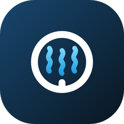
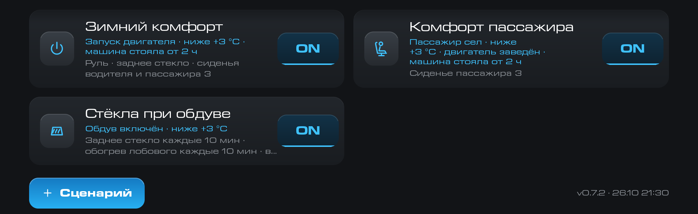
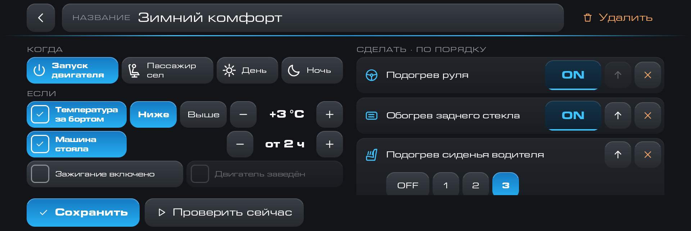
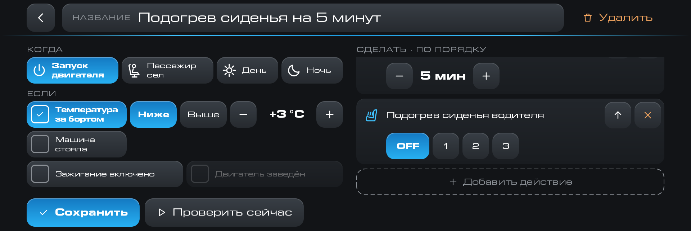
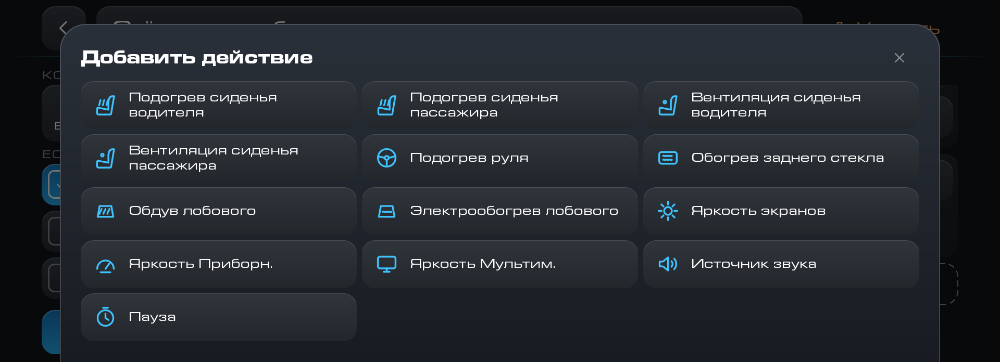

# GWM Comfort

Сценарии комфорта для головных устройств GWM: на событие машины приложение само включает подогрев и обогрев и меняет яркость экранов.

Каждую зиму одно и то же: завёл двигатель, включил подогрев руля, заднего стекла и сиденья, а
вечером убавил яркость экранов. Приложение запоминает такие привычки и выполняет их само:
по запуску двигателя, по смене дня и ночи, когда в соседнее кресло сел пассажир.

> Завёл двигатель, за бортом ниже +3 °C, машина стояла больше двух часов — включились подогрев
> руля, заднего стекла и сиденья водителя.

## Как устроен сценарий

Сценарий состоит из трёх частей.

- «Когда» — событие, которое запускает сценарий: запуск двигателя, день, ночь, «пассажир сел» и
  «включение» (ГУ загрузилось или проснулось из сна).
- «Если» — условия, при которых сценарий сработает. Это температура за бортом ниже или выше
  заданной (от −40 до +40 °C), включённое зажигание, заведённый двигатель и стоянка не меньше
  выбранного числа часов (от 1 до 24). Условие включается галочкой, а без галочек сценарий
  срабатывает всегда.
- «Сделать» — действия по порядку. Подогрев и вентиляция сиденья водителя и пассажира (OFF, 1,
  2, 3), подогрев руля, обогрев заднего стекла, обдув и электрообогрев лобового. Общая яркость
  экранов (1–10) и поправки яркости «Приборн.» и «Мультим.» (от −5 до +5). Источник звука: радио
  FM и AM, USB, Bluetooth. Пауза от 1 до 30 минут.

Любое действие можно добавлять несколько раз. Так получается подогрев сиденья на пять минут:
включить на 3, подождать 5 минут, выключить.

У обогрева заднего стекла и электрообогрева лобового есть повтор «каждые N минут» (от 1 до 60).
У машины эти обогревы выключаются сами по таймеру, и приложение включает их заново, если они
выключены. Повтор заканчивается, когда условие сценария перестало выполняться (например,
температура поднялась выше порога) или выключено зажигание. Заканчивает его и обратное событие.
Для «запуска двигателя» это заглушённый двигатель, для «дня» и «ночи» — смена на
противоположное, для «включения» — выключение или сон ГУ. «Проверить сейчас» выполняет действие один раз, без
повтора.

## Вместо «Яркость день/ночь»

Сценарии «Яркость днём» и «Яркость ночью» делают то же, что приложение
[«Яркость день/ночь»](../dimmer/README.md) («Автоматическая яркость ГУ»). Когда машина
переключается между днём и ночью, они ставят свою яркость экранов. Поправки «Приборн.» и
«Мультим.» тоже есть. Поэтому отдельное приложение яркости больше не нужно. Оба сразу не
ставьте: они будут перебивать друг друга.

## Готовые сценарии

При первой установке в списке четыре сценария. Их можно править, выключать и удалять,
обновления приложения ничего не возвращают и не трогают.

- «Яркость днём»: на событие «день» ставит яркость 10.
- «Яркость ночью»: на событие «ночь» ставит яркость 1.
- «Зимний комфорт»: после запуска двигателя при температуре за бортом ниже +3 °C включает руль,
  заднее стекло и сиденья. Условие «машина стояла от 2 ч» не даёт включать всё заново после
  короткой остановки.
- «Комфорт пассажира»: подогрев сиденья пассажира, когда пассажир сел в холодную машину.

## Что ещё умеет

- «Проверить сейчас» выполняет действия сразу и показывает ход по шагам: галочка — сделано,
  прочерк с причиной — пропущено. Паузу можно пропустить, всю проверку остановить.
- Команды идут одной очередью. Приложение не шлёт команды чаще раза в 0,7 с, а после запуска
  двигателя ждёт 4 секунды: пока крутит стартёр, климат команд не принимает. Записанное
  значение проверяется и при необходимости пишется ещё раз.
- Обогрев стёкол в машине работает как кнопка: каждое нажатие переключает. Приложение нажимает,
  только если знает, что состояние сейчас другое.
- Вентиляция сидений есть не в каждой комплектации. Если её нет (у части Haval Dargo), плиток
  вентиляции в приложении нет, а добавленный шаг пропускается с пометкой «нет в комплектации».
- Если источника звука нет (USB без флешки, Bluetooth без телефона), шаг пропускается с причиной.
- Источник звука приложение запускает само и старается не открывать штатное приложение «Медиа»
  на экране. Если не получилось, оно переключает источник как раньше, и «Медиа» открывается.
- Размер окна. На всём экране две колонки, в боковой панели одна колонка с вкладками.
- Работа в фоне. Приложение запускается вместе с ГУ и реагирует на события машины.

## Чего приложение не делает

- Нет датчика температуры в салоне: условие считается по температуре за бортом.
- Нет отдельного датчика пассажира. «Пассажир сел» срабатывает по лампе «не пристёгнут»: если
  пассажир сел, а ремень не пристегнул, лампа загорается. Пристегнувшийся заранее остаётся
  незамеченным.
- Выключение ГУ не может быть событием: к этому моменту яркость уже не принимается.

## Совместимость

Приложение работает на головных устройствах GWM на платформе Aptiv с Android 9, если их
прошивка подписана тестовыми ключами AOSP. Проверено на Tank 300 с прошивкой GWM-club. На Haval
Dargo приложение должно работать, но там его не проверяли.

Если что-то не работает, напишите автору, какая у вас машина и прошивка.

На других машинах и прошивках приложение может не поставиться или не суметь управлять климатом.

## Версии

<!-- versions -->
Актуальная версия — **0.7.1** от 26.10.2026: [comfort-0.7.1.apk](https://github.com/theKomix/gwm-apps/releases/download/comfort-v0.7.1/comfort-0.7.1.apk), [описание релиза](https://github.com/theKomix/gwm-apps/releases/tag/comfort-v0.7.1).

- «Источник звука» не открывает приложение «Медиа» на экране: приложение само запускает службу радио, USB или Bluetooth. Если не вышло, переключает как раньше, с экраном.
- Приложение меньше нагружает ГУ: пауза в сценарии считает время одним таймером, журнал пишется реже, на лампы приборки приложение не подписывается.
- Экран «Логи» в релизной сборке спрятан. Он включается семью нажатиями на номер версии внизу списка сценариев и выключается кнопкой на самом экране.

Предыдущие версии:

0.7 от 23.10.2026

- Новое событие «Включение»: ГУ загрузилось или проснулось из сна.
- Новое действие «Источник звука»: радио FM и AM, USB, Bluetooth.
- Новые действия «Вентиляция сиденья водителя» и «Вентиляция сиденья пассажира». Если вентиляции нет в комплектации, плиток нет, а шаг пропускается.
- Повтор «каждые N мин» у обогрева заднего стекла и электрообогрева лобового: приложение включает обогрев заново, если машина выключила его по таймеру.
- Яркости задаются шкалой из полос, как в приложении «Яркость день/ночь».

[comfort-0.7.apk](https://github.com/theKomix/gwm-apps/releases/download/comfort-v0.7/comfort-0.7.apk), [описание релиза](https://github.com/theKomix/gwm-apps/releases/tag/comfort-v0.7).

0.6 от 22.10.2026

- События: запуск двигателя, день, ночь, «пассажир сел».
- Условия: температура за бортом, включённое зажигание, заведённый двигатель, стоянка от 1 до 24 часов.
- Действия: подогрев сидений и руля, обогрев заднего стекла, обдув и электрообогрев лобового, яркость экранов, поправки «Приборн.» и «Мультим.», пауза. Любое действие можно добавлять несколько раз: например, подогрев сиденья на 5 минут и затем выключение.
- Четыре готовых сценария: «Яркость днём», «Яркость ночью», «Зимний комфорт», «Комфорт пассажира». Первые два заменяют приложение «Яркость день/ночь».
- «Проверить сейчас» выполняет сценарий сразу и показывает каждый шаг.
- Экран не мерцает, надписи помещаются в шрифте ГУ, обновление не сбрасывает ваши правки готовых сценариев.

[comfort-0.6.apk](https://github.com/theKomix/gwm-apps/releases/download/comfort-v0.6/comfort-0.6.apk), [описание релиза](https://github.com/theKomix/gwm-apps/releases/tag/comfort-v0.6).

[Все версии и описания](https://github.com/theKomix/gwm-apps/releases?q=comfort)
<!-- /versions -->

## Установка

1. Скачайте APK актуальной версии из раздела [Версии](#версии).
2. Поставьте его тем способом, которым вы ставите приложения на своё ГУ. Как поставить
   приложение без модифицированной прошивки и DSp, описано
   [в инструкции](../INSTALL.md), а на прошивке GWM-club — [в этой](../INSTALL-CLUB.md).
3. Один раз откройте «GWM Comfort». Без первого запуска Android не будет запускать
   приложение при включении ГУ. Добавлять его в «Автозапуск» не нужно.

Новая версия ставится поверх старой, ваши сценарии сохраняются. Удаляется приложение как обычное.

## Поддержать

Если приложение пригодилось, можно [поблагодарить автора](https://pay.cloudtips.ru/p/1e6ed2bf).

---

Неофициальный проект, не связан с Great Wall Motor и Aptiv. Названия и марки принадлежат их владельцам.

Приложение распространяется «как есть». Оно управляет подогревом, обогревом стёкол и яркостью
экранов, то есть теми же функциями, что и штатные кнопки.
