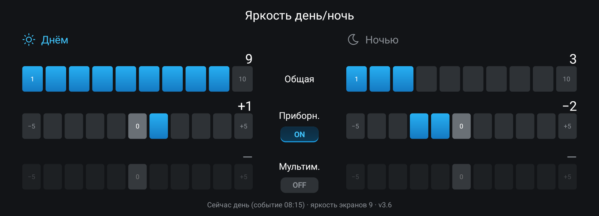
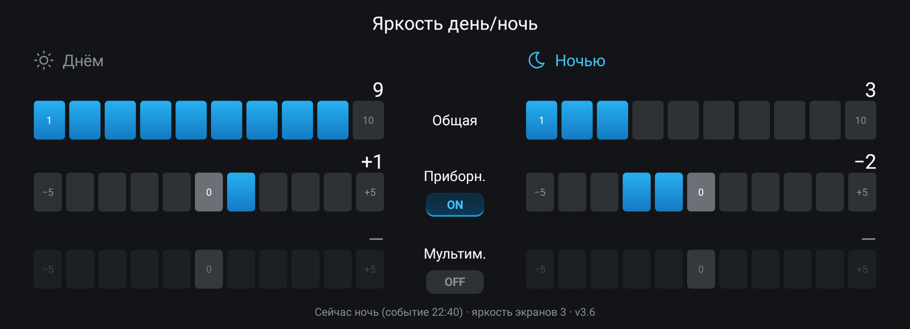

# Яркость день/ночь

Отдельная яркость экранов днём и ночью для головных устройств GWM.

Штатная регулировка яркости одна на всё время. Днём хочется максимум, а ночью он слепит,
и приходится каждый вечер убавлять, а утром прибавлять. Приложение помнит два уровня, дневной
и ночной, и переключает их само вслед за автосветом машины.

Слева шкалы дня, справа ночи; название режима, который сейчас решила машина, подсвечено.
Строка внизу показывает этот режим и какая яркость выставлена.

## Что умеет

- Шкала «Общая» из 10 делений, отдельная для дня и для ночи, меняет общую яркость экранов ГУ
  и приборной панели — ту же, что в штатных настройках.
- Поправки «Приборн.» и «Мультим.» от −5 до +5, как в штатных настройках яркости: приборная
  панель и экран ГУ получают свою добавку к общей яркости. Днём и ночью поправки свои.
  Каждая включается переключателем ON / OFF сразу для дня и ночи. Выключенную приложение не
  трогает: на ГУ остаётся значение из штатных настроек. После установки обе поправки
  выключены.
- Яркость переключается по решению автосвета: он смотрит на датчик освещённости и фары. Днём
  одного включения фар мало, поэтому для проверки закройте датчик света рукой.
- Тема оформления не важна: светлая, тёмная или «авто».
- Приложение запускается вместе с ГУ и работает в фоне. По таймеру оно ничего не опрашивает:
  о смене дня и ночи машина сообщает сама, поэтому лишней нагрузки на ГУ нет.
- Если поменять яркость штатным ползунком, приложение не тронет её до следующей смены дня
  и ночи.
- Когда вы двигаете шкалу текущего режима, яркость меняется сразу.

## Совместимость

Приложение работает на головных устройствах GWM на платформе Aptiv с Android 9, если их
прошивка подписана тестовыми ключами AOSP. Переключение общей яркости по дню и ночи проверено
на Tank 300 с прошивкой GWM-club и на Haval Dargo со штатной прошивкой. Поправки приборной
панели и экрана ГУ проверены на Tank 300 со штатной прошивкой 4013, на Haval Dargo не
проверялись. DSp на Dargo нужен только для лёгкой установки приложений, само приложение от
него не зависит.

На других машинах и прошивках приложение может не поставиться или не суметь менять яркость.

## Версии

<!-- versions -->
Актуальная версия — **3.6** от 22.10.2026: [dimmer-3.6.apk](https://github.com/theKomix/gwm-apps/releases/download/dimmer-v3.6/dimmer-3.6.apk), [описание релиза](https://github.com/theKomix/gwm-apps/releases/tag/dimmer-v3.6).

- Поправки «Приборн.» и «Мультим.» от −5 до +5, как в штатных настройках яркости: приборная панель и экран ГУ получают свою добавку к общей яркости, отдельно днём и ночью.
- Каждая поправка включается переключателем ON / OFF сразу для дня и ночи. Выключенную приложение не трогает. После обновления обе выключены, и приложение работает как раньше.
- Новый экран: шкалы горизонтальные, во всю ширину, цвета как у остальных приложений tank300.

Предыдущие версии:

3.5 от 22.10.2026

- День и ночь приложение узнаёт прямо от машины (датчик освещённости и фары), без опроса и независимо от темы оформления.
- После включения ГУ приложение дожидается, пока служба машины будет готова.
- Окно занимает всю ширину экрана; раньше на некоторых ГУ оно было узким и прижималось вправо.
- Экран подстраивается под размер окна и плотность экрана ГУ.
- Нужен Android 9 или новее.

[dimmer-3.5.apk](https://github.com/theKomix/gwm-apps/releases/download/dimmer-v3.5/dimmer-3.5.apk), [описание релиза](https://github.com/theKomix/gwm-apps/releases/tag/dimmer-v3.5).

[Все версии и описания](https://github.com/theKomix/gwm-apps/releases?q=dimmer)
<!-- /versions -->

## Установка

1. Скачайте APK актуальной версии из раздела [Версии](#версии).
2. Поставьте его тем способом, которым вы ставите приложения на своё ГУ. Как поставить
   приложение без модифицированной прошивки и DSp, описано
   [в инструкции](../INSTALL.md), а на прошивке GWM-club — [в этой](../INSTALL-CLUB.md).
3. Один раз откройте «Яркость день/ночь» и выставьте шкалы. Без первого запуска Android не
   будет запускать приложение при включении ГУ. Добавлять его в «Автозапуск» не нужно.
4. Чтобы управлять поправками, включите «Приборн.» или «Мультим.» переключателем ON.

Новая версия ставится поверх старой, настройки сохраняются. Удаляется приложение как обычное.

## Строка внизу экрана

Строка внизу показывает текущий режим, откуда он известен, яркость экранов и версию, например
«Сейчас день (событие 18:05) · яркость экранов 6 · v3.6». «Событие» значит, что о смене
сообщила машина, «прочитано при подключении» — что режим узнали при запуске.

Сразу после включения ГУ там может быть «подключаюсь к машине…»: служба машины готова
не сразу. Если надпись держится дольше минуты, приложение на этом ГУ не работает.

## Поддержать

Если приложение пригодилось, можно [поблагодарить автора](https://pay.cloudtips.ru/p/1e6ed2bf).

---

Неофициальный проект, не связан с Great Wall Motor и Aptiv. Названия и марки принадлежат их владельцам.

Приложение распространяется «как есть». Оно меняет только яркость экранов и приборной панели —
те же настройки, что и штатное меню.
