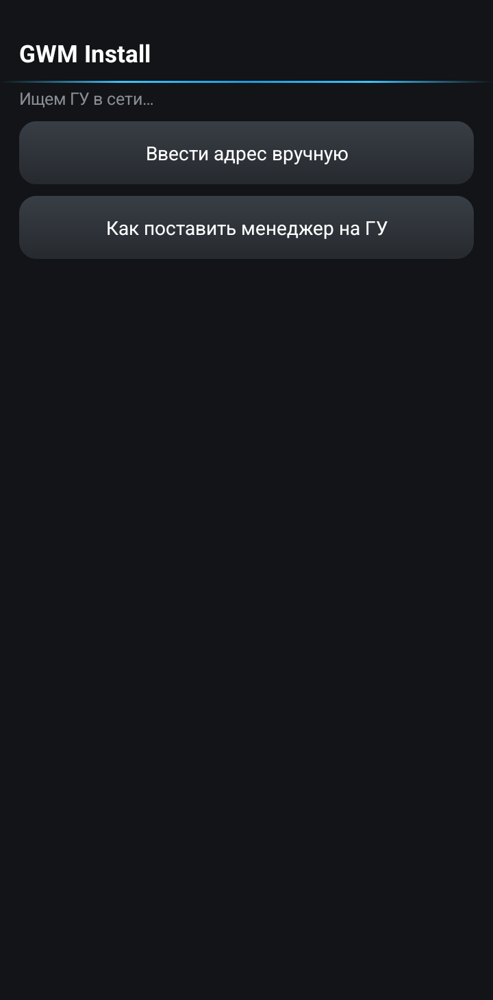
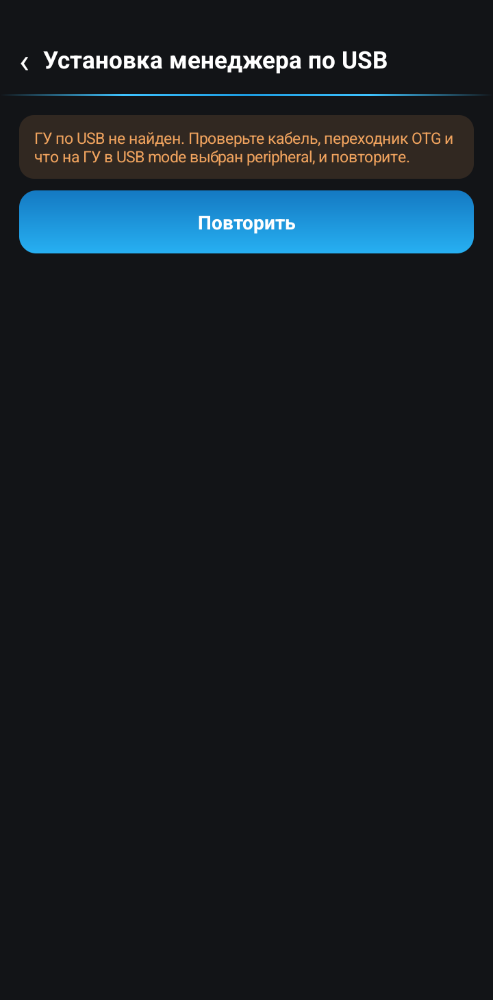
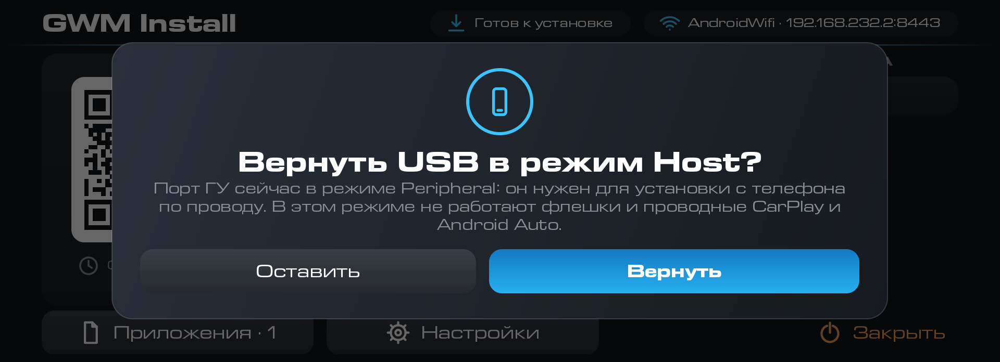
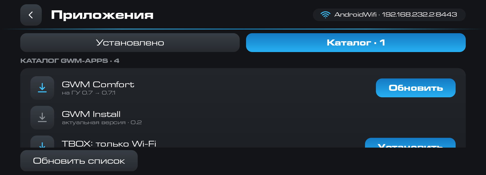
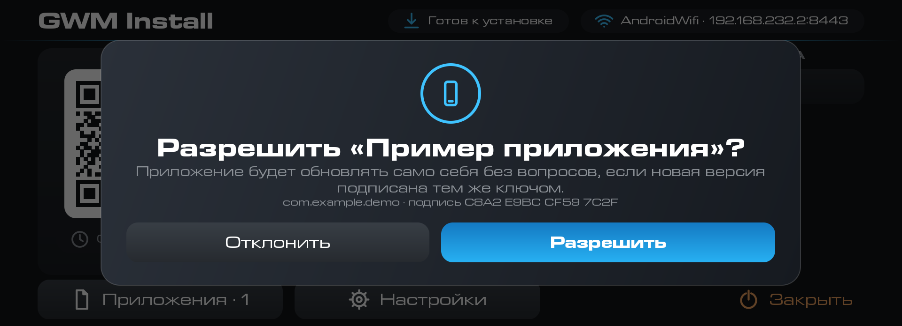

# GWM Install

> Приложение бесплатно. Если оно пригодилось, можно [поблагодарить автора](https://pay.cloudtips.ru/p/1e6ed2bf).

GWM Install — менеджер, который ставит приложения на ГУ с телефона по Wi-Fi, и на штатных
прошивках, и на модифицированных. На ГУ работает приёмник. Android-телефону нужен клиент, а iPhone обходится браузером: приёмник сам отдаёт веб-интерфейс, который открывается по QR. Телефон
сопрягается с ГУ один раз, после чего APK выбирается на телефоне и ставится на ГУ. Штатные прошивки
превращают любую установку приложения в квест с проводом и adb. Поэтому менеджер нужно поставить на ГУ один раз, кабелем. С версии 0.2 клиент на телефоне ставит приёмник на ГУ сам по USB, без компьютера. Дальше провод не нужен. У менеджера есть свой экран Wi-Fi
вместо скрытых системных настроек, ГУ подключается к точке доступа телефона прямо из приложения, и
все остальные приложения ставятся с телефона по Wi-Fi. На модифицированных прошивках менеджер
заменяет привычную цепочку: запустить FTP-сервер, скопировать APK и открыть его на ГУ.

## Как установить на ГУ

Менеджер состоит из двух приложений: приёмника для ГУ и клиента для телефона. Сначала на телефон
ставится клиент, а приёмник на штатной прошивке клиент ставит на ГУ сам.

1. Скачайте на телефон последнюю версию клиента `gwm-install-phone-…` из раздела
   [Версии](#версии) и установите её. Нужен Android 10 или новее. Android спросит разрешение на
   установку приложений из этого источника, разрешите его. На iPhone ничего ставить не нужно:
   приёмник на ГУ сам отдаёт веб-интерфейс.
2. Поставьте приёмник на ГУ. Способ зависит от прошивки.

   Штатная прошивка. Подключите телефон к левому USB-разъёму ГУ проводом: через переходник OTG
   и кабель USB-A — USB-A. Дальше откройте в клиенте «Как поставить менеджер на ГУ»: подробная
   инструкция по шагам, с инженерным меню ГУ, лежит в самом приложении, там же кнопка
   «Установить менеджер на ГУ по USB». APK приёмника уже вшит в клиент, интернет не нужен. Если
   на ГУ появится окно «Отладка по USB», нажмите «ОК». Потом откройте «GWM Install» на ГУ и
   согласитесь на «Вернуть USB в режим Host?»: пока включён «peripheral», флешки, проводной
   CarPlay и Android Auto на ГУ не работают.

   Телефон сопрягается с ГУ ещё по кабелю: ГУ появится в клиенте как «ждём в сети», а позже
   телефон найдёт его по отпечатку, QR не нужен. Для этого ГУ должно оказаться в одной сети Wi-Fi
   с телефоном, например в точке доступа телефона. Если клиент написал, что сопряжение не
   вышло, сопрягите телефон по QR, как в разделе «Как пользоваться».

   
   
   

   

   Если Android-телефона нет, приёмник на штатной прошивке ставится только с ноутбука через adb.
   Скачайте `gwm-install-hu-…` из раздела [Версии](#версии), включите на ГУ USB mode
   «peripheral» (шаги в [инструкции](../INSTALL.md)) и поставьте файл командой `adb install`.

   Прошивка GWM-club. USB-режим менять не нужно. Скачайте `gwm-install-hu-…` из раздела
   [Версии](#версии), передайте его на ГУ по FTP и установите из файлового менеджера по
   [инструкции](../INSTALL-CLUB.md).
3. Откройте «GWM Install» на ГУ. Если телефон сопрягся по кабелю, дальше ничего делать не
   нужно, иначе приложение покажет QR. Порядок действий описан в разделе «Как пользоваться».

Установка с телефона по USB и сопряжение по кабелю проверены на Tank 300: работают.

Если антивирус на телефоне ругается на клиент, поставьте облегчённую версию `gwm-install-lite-…`. В ней нет файла приёмника, поэтому `gwm-install-hu-…` скачайте на телефон отдельно и выберите его при установке по USB. Порядок шагов в [инструкции](../INSTALL.md).

Новая версия ставится поверх старой, настройки сохраняются. Менеджер умеет обновлять сам себя
из каталога: такая установка всегда подтверждается на ГУ.

С версии 0.2 обновляйте оба приложения: менеджер на ГУ и клиент на телефоне. Старый менеджер
не проверяет подписи релизов и каталога на ГУ не имеет. Новый клиент показывает только релизы с
подписью автора, и она есть у всех релизов витрины.

## Как пользоваться

### Сопряжение, один раз

1. ГУ и телефон должны быть в одной сети. Проще всего подключить ГУ к точке доступа на телефоне.
   Откройте «GWM Install» на ГУ: на экране появится QR.

   

2. Наведите на QR камеру телефона. На Android откроется клиент и спросит «Подключиться к ГУ?».
   Нажмите «Подключиться».

   

3. На ГУ появится окно: телефон хочет стать доверенным и ставить приложения. Нажмите «Разрешить».
   Так проверяется каждый новый телефон.

   

4. Клиент покажет, что ГУ подключено. Отсюда доступны «Выбрать APK», «Каталог gwm-apps» и
   «Приложения на ГУ». Подключённый телефон появится на экране ГУ в списке сопряжённых устройств.

   

   

На iPhone та же камера откроет страницу в браузере. Safari один раз предупредит о сертификате,
вход действует 2 часа. Когда он закончится, отсканируйте QR снова.

### Установка приложения

1. В клиенте нажмите «Выбрать APK» и выберите файл. Клиент покажет, что за файл: приложение,
   версию, что стоит на ГУ сейчас, какая версия будет и совпадает ли подпись. Метка
   «Новое приложение» значит, что на ГУ его ещё нет. Нажмите кнопку «Установить на …» с именем вашего ГУ.

   

2. Файл передаётся на ГУ. На телефоне и на ГУ видна полоса с процентами, передачу можно отменить.

   

   

3. Если включена настройка «Запрос установки», ГУ спрашивает подтверждение. Телефон в это время
   пишет «Подтвердите на экране ГУ». Нажмите «Установить» на ГУ.

   

   

4. Когда всё готово, телефон пишет «Готово», а ГУ — «Установлено». Приложение можно открыть
   сразу, с телефона («Открыть на ГУ») или с ГУ, или выбрать следующий файл («Установить ещё»).

   

   

### Список приложений и удаление

1. В клиенте откройте «Приложения на ГУ». Там видны установленные на ГУ приложения, кроме системных, с версиями.
   Нажмите «Удалить» у нужного и подтвердите на телефоне.

   

   

2. ГУ всегда просит подтвердить удаление на своём экране, даже когда «Запрос установки»
   выключен. Нажмите «Удалить».

   

3. Телефон пишет «Удалено».

   

Список приложений есть и на самом ГУ: кнопка «Приложения» на главном экране, у каждого приложения
«Открыть» и «Удалить».

### Каталог gwm-apps

«Каталог gwm-apps» в клиенте сверяет приложения на ГУ с витриной. Что ещё не установлено, можно
поставить кнопкой «Установить», а приложения с новой версией попадают в раздел «Обновления».
Скачивание идёт на телефоне, интернет на ГУ не нужен. После подключения телефона к ГУ клиент один раз за
версию показывает окно «На ГУ есть обновления».

### Каталог на самом ГУ

С версии 0.2 каталог есть и на ГУ: вкладка «Каталог» на экране «Приложения». Менеджер сам читает
релизы витрины, показывает «Установить» и «Обновить», скачивает файл и ставит его обычной
операцией. Число обновлений видно на кнопке «Приложения». Телефон для этого не нужен.

Каталог на ГУ выходит в сеть только через Wi-Fi: SIM T-Box не используется, даже если она сеть
по умолчанию. Без Wi-Fi вкладка пишет «Нет Wi-Fi: подключите ГУ к сети с интернетом», а когда
Wi-Fi появится, список загружается сам. Если у сети Wi-Fi нет выхода в интернет, вкладка говорит
об этом. При сбое защищённого соединения проверьте дату и время на ГУ.

### Подпись релизов

Релизы витрины подписаны автором. У каждого APK в релизе есть файл `<имя APK>.sig`, и менеджер
на ГУ вместе с клиентом на телефоне проверяют подпись по сумме скачанного файла, тегу релиза и
имени файла. Поэтому подменить файл или выдать подписанный APK за другой релиз нельзя. Релиз без
подписи в каталоге не показывается, пакет внутри APK должен совпасть с пакетом из каталога. В окне
подтверждения на ГУ такая установка помечена «подписано автором», а APK без верной подписи
считается обычным, «с устройства …».

### Приложения ГУ обновляют сами себя

Приложения на самом ГУ могут просить менеджер обновить их. Владелец один раз разрешает это
приложению в окне «Разрешить «название»?», разрешение привязано к пакету и подписи. Дальше
приложение передаёт менеджеру новый APK, и менеджер ставит его без окна установки Android, если
пакет тот же, версия выше, подпись совпадает и у APK нет рискованных прав. Во всех остальных
случаях идёт обычная установка с подтверждением. На экране «Устройства» есть блок «Приложения ГУ,
которым разрешено обновлять себя» с кнопкой «Забыть». Настройка «Запрос установки» остаётся
главной, а в журнале такая установка записана как «название (это ГУ)».

## Что умеет

- Ставит APK с телефона на ГУ по Wi-Fi без кабеля и FTP.
- Ставит сам приёмник на ГУ с телефона по USB на штатной прошивке: APK приёмника вшит в клиент.
- Принимает APK из «Поделиться» в файловом менеджере телефона.
- Показывает список приложений на ГУ и удаляет их. Удаление всегда подтверждается на ГУ.
- Предлагает обновления из каталога gwm-apps, в том числе обновляет сам менеджер.
- Показывает каталог gwm-apps и на самом ГУ, без телефона, если у ГУ есть Wi-Fi с интернетом.
- Проверяет подпись автора у каждого релиза витрины, прежде чем предложить или поставить его.
- Позволяет приложениям на ГУ обновлять себя через менеджер, если владелец это разрешил.
- Спрашивает подтверждение на ГУ при установке, понижении версии и подключении нового
  телефона. Журнал в настройках показывает, что, когда и с какого устройства ставили.
- Имеет свой экран Wi-Fi для прошивок, на которых системные настройки сети скрыты.

## Настройки

Настройки открываются на ГУ.

- «Запрос установки» — по умолчанию выключено: APK с сопряжённого телефона ставится без запроса.
  Если включить, ГУ спрашивает подтверждение при каждой установке.
- «Запрос понижения» — подтверждение, если версия ниже установленной. По умолчанию включено.
- «Запрос нового устройства» — окно «Разрешить?» при сопряжении нового телефона. По умолчанию
  включено.
- «Только при открытии» — менеджер работает, пока приложение открыто на ГУ. Второй вариант,
  «Всегда, с запуском ГУ», держит службу включённой постоянно, и ГУ всегда видно в сети.

## Совместимость

Приёмнику нужно ГУ GWM на платформе Aptiv с Android 9. Клиенту для телефона нужен Android 10 или
новее. На iPhone работает веб-страница, ставить ничего не нужно.

Проверено на Tank 300 с модифицированной прошивкой GWM-club и со штатной прошивкой 4013. На штатной
прошивке система не пускает сторонние установщики, поэтому менеджер ставит APK через отладку самого
ГУ. В версии 0.1 на проверенном ГУ окно «Отладка по USB» не появилось. Если оно появится на вашем,
нажмите «ОК» в течение двух минут.

В версии 0.1.1 менеджер сам включает «отладку по Wi-Fi», если она выключена. Он переключает USB-режим
ГУ в «TCP/IP (ADB по Wi-Fi)», ждёт, пока откроется порт, ставит или удаляет приложение и возвращает
прежний режим. Режим меняется только после отказа системы, на прошивках с прямой установкой его не
трогают. Если включить отладку не удалось, включите «Отладку по Wi-Fi» в инженерном меню ГУ. Пока включён режим TCP/IP, USB-порт ГУ может не работать как Host: это
флешки, проводной CarPlay и Android Auto. Режим меняется на время установки и возвращается.

Установка менеджера на ГУ с телефона по USB (версия 0.2) и сопряжение по кабелю проверены на
Tank 300: работают. Пока на ГУ включён «peripheral», флешки и проводной CarPlay и Android Auto
не работают, поэтому приёмник предлагает вернуть Host.

На Haval Dargo со штатной прошивкой 5012 менеджер сработал.

## Чего пока нет

Режима «Не ставить в движении» нет. Менеджер ставит любой APK, который вы отправили с сопряжённого
телефона, поэтому проверяйте, откуда взят файл.

## Версии

<!-- versions -->
Актуальная версия — **0.2.1** от 27.10.2026: [gwm-install-hu-0.2.1.apk](https://github.com/theKomix/gwm-apps/releases/download/gwm-install-v0.2.1/gwm-install-hu-0.2.1.apk), [gwm-install-lite-0.2.1.apk](https://github.com/theKomix/gwm-apps/releases/download/gwm-install-v0.2.1/gwm-install-lite-0.2.1.apk), [gwm-install-phone-0.2.1.apk](https://github.com/theKomix/gwm-apps/releases/download/gwm-install-v0.2.1/gwm-install-phone-0.2.1.apk), [описание релиза](https://github.com/theKomix/gwm-apps/releases/tag/gwm-install-v0.2.1).

- Облегчённый клиент `gwm-install-lite-0.2.1.apk` без файла приёмника внутри. Антивирус «СберБанк Онлайн» принял за угрозу обычный клиент, в котором лежит APK приёмника, а облегчённый не тронул. На других антивирусах не проверялось. Пакет и подпись у облегчённого клиента те же, что у обычного, пользоваться им можно так же.
- Если ставите облегчённый клиент, приёмник `gwm-install-hu-0.2.1.apk` скачайте на телефон отдельно. Ставить его на телефоне не нужно: это файл для ГУ. В справке клиента первым шагом стоит «Скачайте файл» и кнопка «Открыть страницу GWM Install». При установке по USB выберите скачанный файл: клиент проверит, что это приёмник GWM Install с нужной подписью, и чужой APK отклонит.
- Обычный клиент и приёмник работают как в 0.2, версия поднята до 0.2.1. Порядок шагов для облегчённого клиента описан в [инструкции](https://github.com/theKomix/gwm-apps/blob/main/INSTALL.md), раздел «Если антивирус ругается на клиент».

Предыдущие версии:

0.2 от 27.10.2026

- Менеджер ставится на ГУ прямо с телефона. В клиенте появились кнопка «Как поставить менеджер на ГУ» и экран «Первая установка на ГУ» с шагами и кнопкой «Установить менеджер на ГУ по USB». APK приёмника вшит в клиент, интернет и каталог не нужны. До ГУ телефон добирается по USB-кабелю: ГУ в режиме USB mode «peripheral», а клиент сам выполняет установку по adb. Сразу после установки телефон сам сопрягается с ГУ по кабелю, а позже находит его в сети по отпечатку, QR не нужен (он остаётся запасным путём). ГУ и телефон должны оказаться в одной сети Wi-Fi, например в точке доступа телефона. После установки приёмник при открытии на ГУ предлагает вернуть USB mode в «host»: пока включён «peripheral», флешки, проводной CarPlay и Android Auto на ГУ не работают.
- Каталог на самом ГУ: вкладка «Каталог» на экране «Приложения». Менеджер сам читает релизы витрины, показывает «Установить» и «Обновить», скачивает файл и ставит его. Число обновлений видно на кнопке «Приложения», телефон не нужен. Нужен Wi-Fi с интернетом: SIM T-Box каталог не использует.
- Релизы витрины подписаны автором: у каждого APK есть файл `.sig`. Менеджер на ГУ и клиент на телефоне проверяют подпись по сумме файла, тегу релиза и имени, поэтому подменить файл или выдать подписанный APK за другой релиз нельзя. Релиз без подписи в каталоге не показывается. В окне подтверждения на ГУ написано «подписано автором».
- Приложения на ГУ могут просить менеджер обновить их. Владелец один раз разрешает это приложению в окне «Разрешить «название»?». Дальше обновление идёт без окна установки Android, если пакет тот же, версия выше, подпись совпадает и у APK нет рискованных прав. Разрешения видны на экране «Устройства» в блоке «Приложения ГУ, которым разрешено обновлять себя», там же кнопка «Забыть».
- Безопасность строже. Пакет в скачанном APK сверяется с каталогом. Обновление самого менеджера из каталога на ГУ подтверждается на ГУ всегда. Окно «Разрешить?» при сопряжении показывает адрес телефона в сети. Токен из QR срабатывает один раз. Резервная копия клиента отключена, недогруженные файлы на ГУ удаляются через 15 минут.
- Прежний USB-режим ГУ возвращается и после перезагрузки ГУ, в любом режиме работы менеджера. Подтверждение переключения ждёт 4 секунды вместо 0,5, поэтому медленный ответ не считается отказом.

[gwm-install-hu-0.2.apk](https://github.com/theKomix/gwm-apps/releases/download/gwm-install-v0.2/gwm-install-hu-0.2.apk), [gwm-install-phone-0.2.apk](https://github.com/theKomix/gwm-apps/releases/download/gwm-install-v0.2/gwm-install-phone-0.2.apk), [описание релиза](https://github.com/theKomix/gwm-apps/releases/tag/gwm-install-v0.2).

0.1.1 от 26.10.2026

- На штатной прошивке менеджер сам включает «отладку по Wi-Fi», если она выключена. Он переключает USB-режим ГУ в «TCP/IP (ADB по Wi-Fi)», как инженерное меню, ждёт, пока откроется порт, ставит или удаляет приложение и возвращает прежний режим. Режим меняется только после отказа системы по белому списку, на прошивках с прямой установкой его не трогают. На телефоне в это время написано «Включаем отладку по Wi-Fi…». Если включить отладку не удалось, менеджер просит включить её в инженерном меню ГУ.

[gwm-install-hu-0.1.1.apk](https://github.com/theKomix/gwm-apps/releases/download/gwm-install-v0.1.1/gwm-install-hu-0.1.1.apk), [gwm-install-phone-0.1.1.apk](https://github.com/theKomix/gwm-apps/releases/download/gwm-install-v0.1.1/gwm-install-phone-0.1.1.apk), [описание релиза](https://github.com/theKomix/gwm-apps/releases/tag/gwm-install-v0.1.1).

0.1 от 23.10.2026

- Приёмник на ГУ и клиент для Android. Телефон сопрягается с ГУ один раз: достаточно навести камеру на QR на экране ГУ.
- iPhone и любой браузер: тот же QR открывает веб-страницу, вход действует 2 часа.
- Отправка APK с телефона на ГУ. Перед установкой видно, что это: новое приложение, обновление, та же версия или понижение, совпадает ли подпись.
- Список приложений ГУ и удаление. Удаление всегда подтверждается на экране ГУ.
- Подтверждения на ГУ: установка, понижение версии, новый телефон. Журнал установок.
- Каталог витрины gwm-apps: клиент предлагает обновить приложения оттуда, в том числе сам менеджер.
- Экран Wi-Fi на ГУ для прошивок, где системные настройки сети скрыты.
- На штатной прошивке система не пускает сторонние установщики, поэтому менеджер ставит APK через отладку самого ГУ.

[gwm-install-hu-0.1.apk](https://github.com/theKomix/gwm-apps/releases/download/gwm-install-v0.1/gwm-install-hu-0.1.apk), [gwm-install-phone-0.1.apk](https://github.com/theKomix/gwm-apps/releases/download/gwm-install-v0.1/gwm-install-phone-0.1.apk), [описание релиза](https://github.com/theKomix/gwm-apps/releases/tag/gwm-install-v0.1).

[Все версии и описания](https://github.com/theKomix/gwm-apps/releases?q=gwm-install)
<!-- /versions -->

---

Неофициальный проект, не связан с Great Wall Motor и Aptiv. Названия и марки принадлежат их владельцам.

Приложение распространяется «как есть». Оно устанавливает и удаляет приложения на ГУ по команде
сопряжённого телефона.
