# GWM Install

GWM Install — менеджер, который ставит приложения на ГУ с телефона по Wi-Fi, и на штатных
прошивках, и на модифицированных. На ГУ работает приёмник. Android-телефону нужен клиент, а iPhone обходится браузером: приёмник сам отдаёт веб-интерфейс, который открывается по QR. Телефон
сопрягается с ГУ один раз, после чего APK выбирается на телефоне и ставится на ГУ. Штатные прошивки
превращают любую установку приложения в квест с проводом и adb. Поэтому менеджер нужно поставить на
ГУ один раз, кабелем, по инструкции. Дальше провод не нужен. У менеджера есть свой экран Wi-Fi
вместо скрытых системных настроек, ГУ подключается к точке доступа телефона прямо из приложения, и
все остальные приложения ставятся с телефона по Wi-Fi. На модифицированных прошивках менеджер
заменяет привычную цепочку: запустить FTP-сервер, скопировать APK и открыть его на ГУ.

## Как установить на ГУ

Менеджер состоит из двух приложений: приёмника для ГУ и клиента для телефона. Ставятся они
по-разному.

1. Скачайте два APK актуальной версии из раздела [Версии](#версии): `gwm-install-hu-…` для ГУ и
   `gwm-install-phone-…` для телефона.
2. Поставьте приёмник на ГУ тем способом, которым вы ставите приложения на своё ГУ. Пошагово:
   - на штатной прошивке — [инструкция](../INSTALL.md): включить отладку в инженерном меню,
     подключить смартфон кабелем и поставить APK через Bugjaeger;
   - на прошивке GWM-club — [инструкция](../INSTALL-CLUB.md): передать APK по FTP и установить
     его из файлового менеджера.
3. Поставьте клиент на телефон с Android 10 или новее: откройте скачанный APK. Android спросит
   разрешение на установку приложений из этого источника, разрешите его.
   На iPhone ничего ставить не нужно: приёмник на ГУ сам отдаёт веб-интерфейс.
4. Откройте «GWM Install» на ГУ. Приложение покажет QR.
   Порядок действий описан в разделе «Как пользоваться».

Новая версия ставится поверх старой, настройки сохраняются. Менеджер умеет обновлять сам себя
из каталога: такая установка всегда подтверждается на ГУ.

## Как пользоваться

### Сопряжение, один раз

1. ГУ и телефон должны быть в одной сети. Проще всего подключить ГУ к точке доступа на телефоне.
   Откройте «GWM Install» на ГУ: на экране появится QR.

   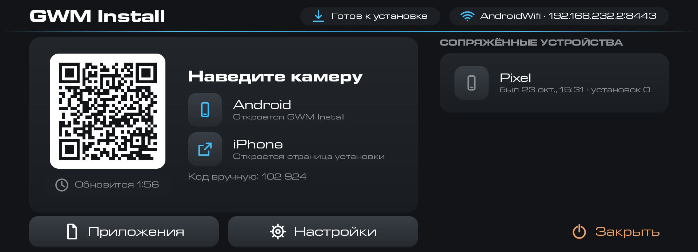

2. Наведите на QR камеру телефона. На Android откроется клиент и спросит «Подключиться к ГУ?».
   Нажмите «Подключиться».

   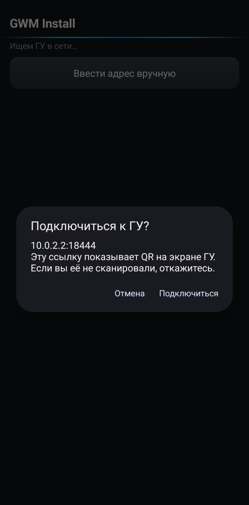

3. На ГУ появится окно: телефон хочет стать доверенным и ставить приложения. Нажмите «Разрешить».
   Так проверяется каждый новый телефон.

   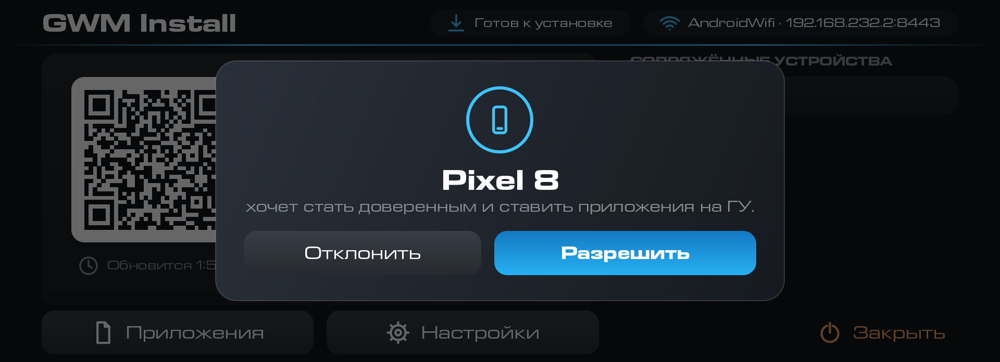

4. Клиент покажет, что ГУ подключено. Отсюда доступны «Выбрать APK», «Каталог gwm-apps» и
   «Приложения на ГУ». Подключённый телефон появится на экране ГУ в списке сопряжённых устройств.

   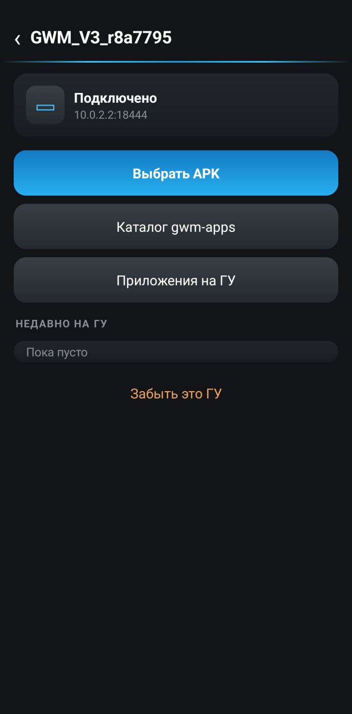

   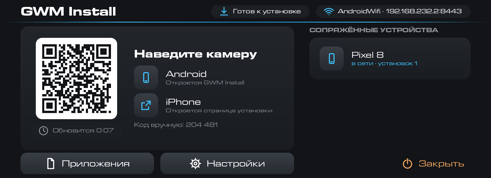

На iPhone та же камера откроет страницу в браузере. Safari один раз предупредит о сертификате,
вход действует 2 часа. Когда он закончится, отсканируйте QR снова.

### Установка приложения

1. В клиенте нажмите «Выбрать APK» и выберите файл. Клиент покажет, что за файл: приложение,
   версию, что стоит на ГУ сейчас, какая версия будет и совпадает ли подпись. Метка
   «Новое приложение» значит, что на ГУ его ещё нет. Нажмите «Установить на ГУ».

   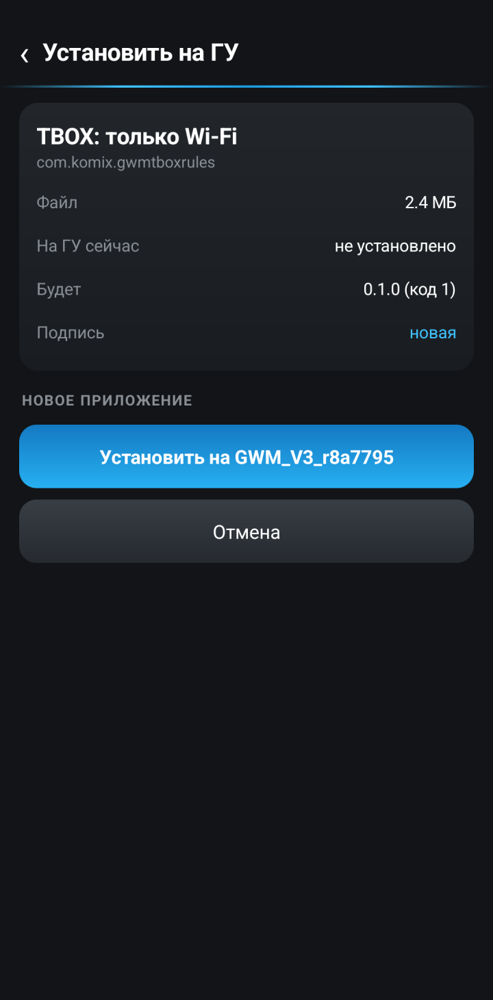

2. Файл передаётся на ГУ. На телефоне и на ГУ видна полоса с процентами, передачу можно отменить.

   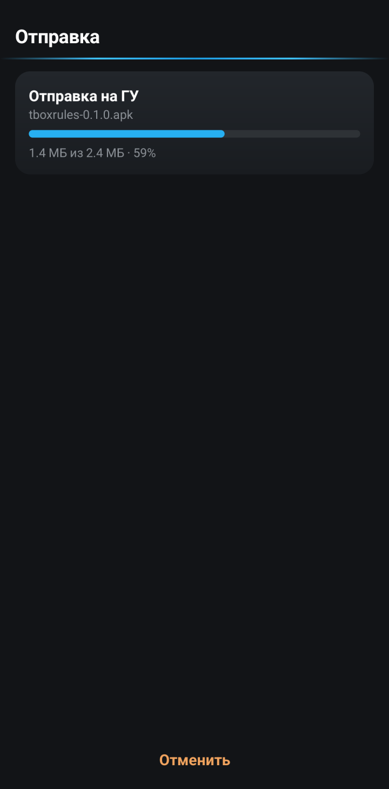

   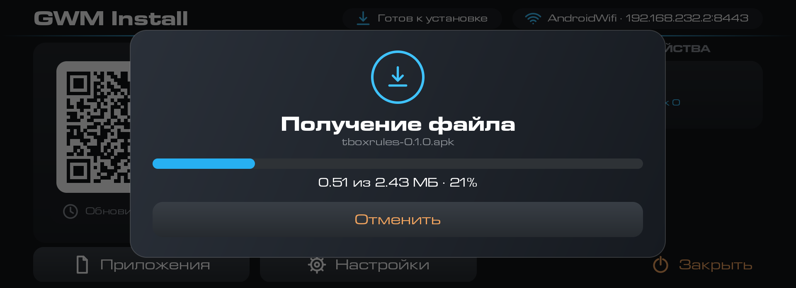

3. Если включена настройка «Запрос установки», ГУ спрашивает подтверждение. Телефон в это время
   пишет «Подтвердите на экране ГУ». Нажмите «Установить» на ГУ.

   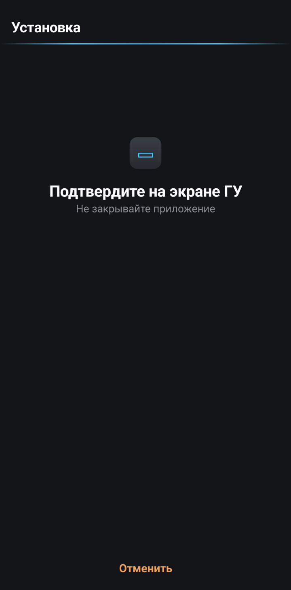

   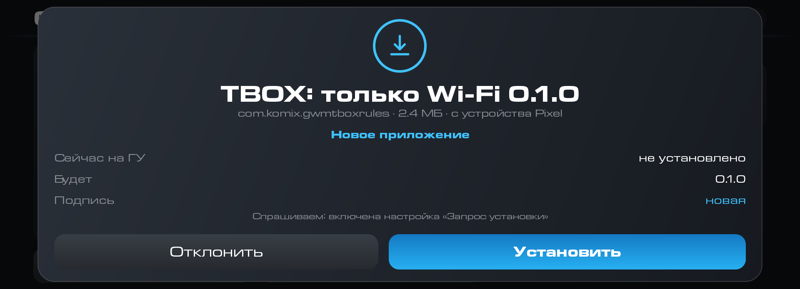

4. Когда всё готово, телефон пишет «Готово», а ГУ — «Установлено». Приложение можно открыть
   сразу, с телефона («Открыть на ГУ») или с ГУ, или выбрать следующий файл («Установить ещё»).

   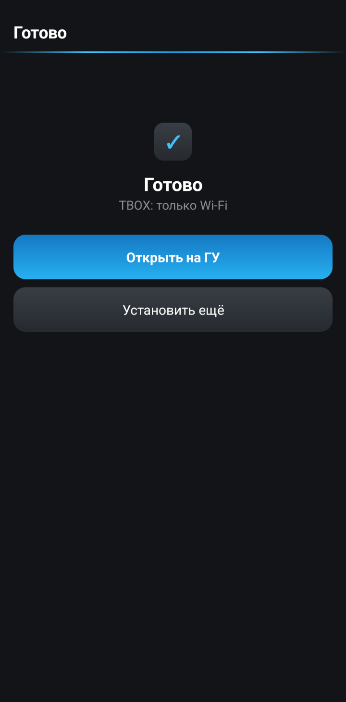

   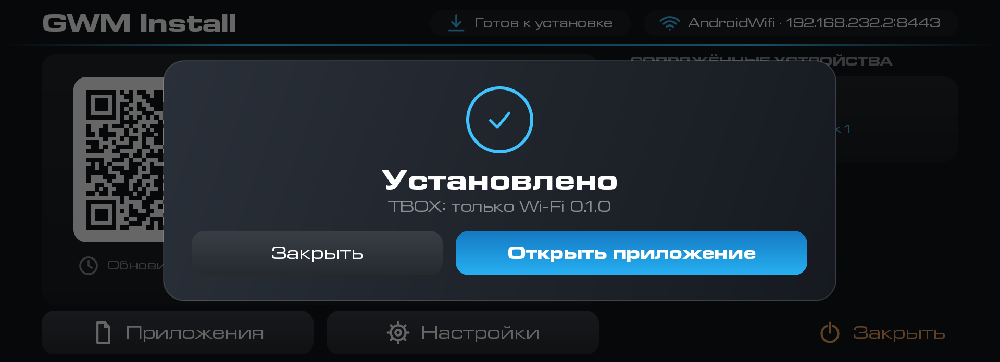

### Список приложений и удаление

1. В клиенте откройте «Приложения на ГУ». Там видны приложения, которые вы ставили, с версиями.
   Нажмите «Удалить» у нужного и подтвердите на телефоне.

   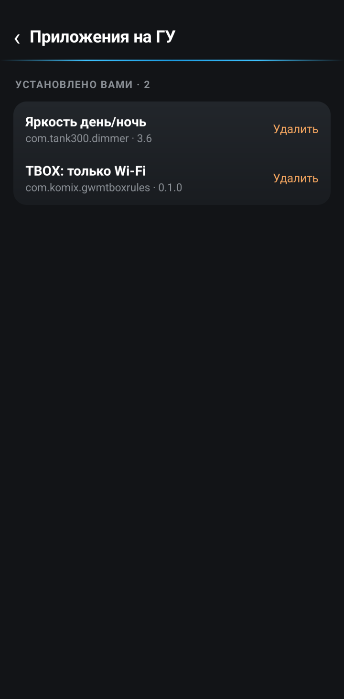

   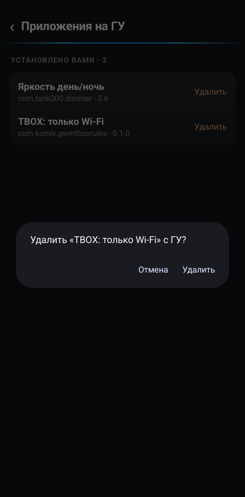

2. ГУ всегда просит подтвердить удаление на своём экране, даже когда «Запрос установки»
   выключен. Нажмите «Удалить».

   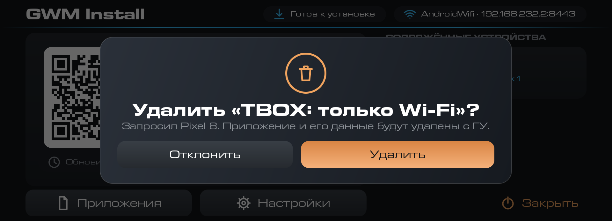

3. Телефон пишет «Удалено».

   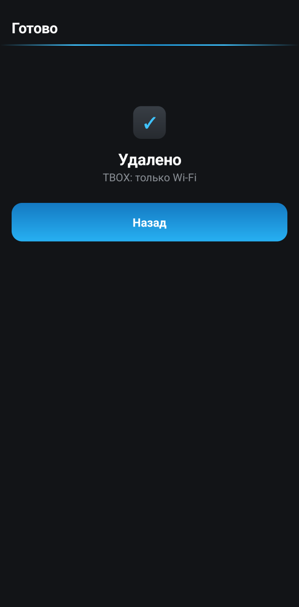

Список приложений есть и на самом ГУ: кнопка «Приложения» на главном экране, у каждого приложения
«Открыть» и «Удалить».

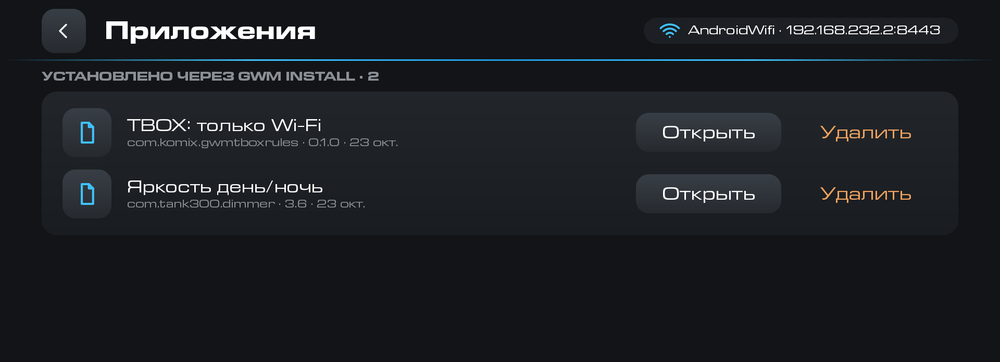

### Каталог gwm-apps

«Каталог gwm-apps» в клиенте сверяет приложения на ГУ с витриной. Что ещё не установлено, можно
поставить кнопкой «Установить», а приложения с новой версией попадают в раздел «Обновления».
Скачивание идёт на телефоне, интернет на ГУ не нужен. После подключения телефона к ГУ клиент один раз за
версию показывает окно «На ГУ есть обновления».

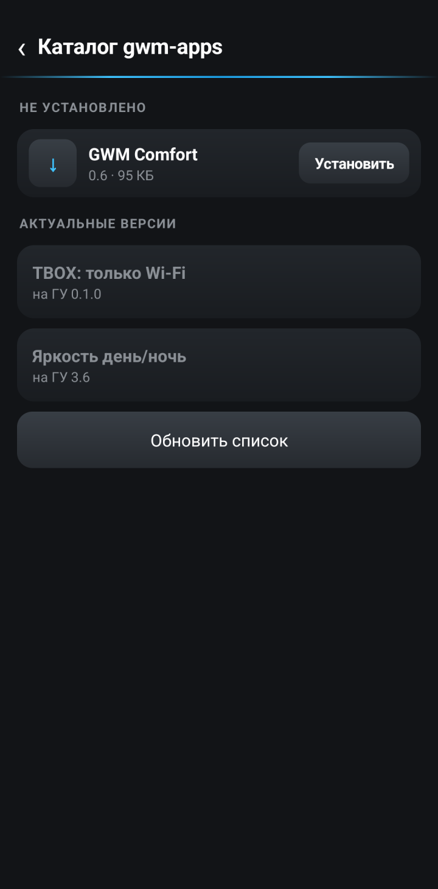

## Что умеет

- Ставит APK с телефона на ГУ по Wi-Fi без кабеля и FTP.
- Принимает APK из «Поделиться» в файловом менеджере телефона.
- Показывает список приложений на ГУ и удаляет их. Удаление всегда подтверждается на ГУ.
- Предлагает обновления из каталога gwm-apps, в том числе обновляет сам менеджер.
- Спрашивает подтверждение на ГУ при установке, понижении версии и подключении нового
  телефона. Журнал в настройках показывает, что, когда и с какого устройства ставили.
- Имеет свой экран Wi-Fi для прошивок, на которых системные настройки сети скрыты.

## Настройки

Настройки открываются на ГУ.

- «Запрос установки» — по умолчанию выключено: APK с сопряжённого телефона ставится без запроса.
  Если включить, ГУ спрашивает подтверждение при каждой установке.
- «Запрос понижения» — подтверждение, если версия ниже установленной. По умолчанию включено.
- «Запрос нового устройства» — окно «Разрешить?» при сопряжении нового телефона. По умолчанию
  включено.
- «Только при открытии» — менеджер работает, пока приложение открыто на ГУ. Второй вариант,
  «Всегда, с запуском ГУ», держит службу включённой постоянно, и ГУ всегда видно в сети.

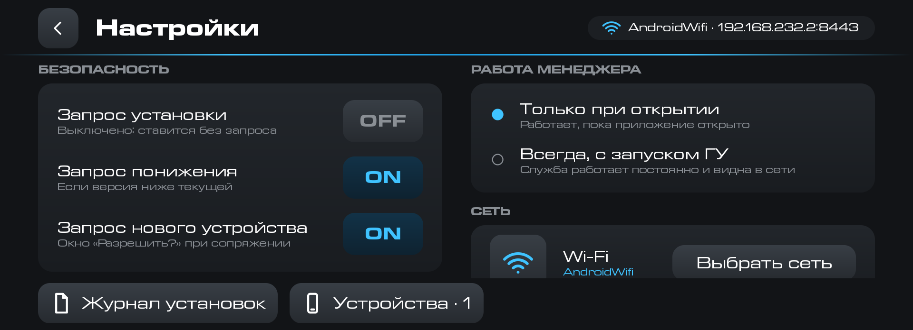

## Совместимость

Приёмнику нужно ГУ GWM на платформе Aptiv с Android 9. Клиенту для телефона нужен Android 10 или
новее. На iPhone работает веб-страница, ставить ничего не нужно.

Проверено на Tank 300 с модифицированной прошивкой GWM-club и со штатной прошивкой 4013. На штатной
прошивке система не пускает сторонние установщики, поэтому менеджер ставит APK через отладку самого
ГУ. На проверенном ГУ окно «Отладка по USB» не появилось. Если оно появится на вашем, нажмите «ОК»
в течение двух минут.

На Haval Dargo менеджер проверял сторонний пользователь. По его сообщению, на штатной прошивке 5012 он
сработал, подробности проверки неизвестны. Сам автор на этом ГУ менеджер не запускал.

## Чего пока нет

Режима «Не ставить в движении» нет. Менеджер ставит любой APK, который вы отправили с сопряжённого
телефона, поэтому проверяйте, откуда взят файл.

## Версии

<!-- versions -->
Актуальная версия — **0.1** от 23.10.2026: [gwm-install-hu-0.1.apk](https://github.com/theKomix/gwm-apps/releases/download/gwm-install-v0.1/gwm-install-hu-0.1.apk), [gwm-install-phone-0.1.apk](https://github.com/theKomix/gwm-apps/releases/download/gwm-install-v0.1/gwm-install-phone-0.1.apk), [описание релиза](https://github.com/theKomix/gwm-apps/releases/tag/gwm-install-v0.1).

- Приёмник на ГУ и клиент для Android. Телефон сопрягается с ГУ один раз: достаточно навести камеру на QR на экране ГУ.
- iPhone и любой браузер: тот же QR открывает веб-страницу, вход действует 2 часа.
- Отправка APK с телефона на ГУ. Перед установкой видно, что это: новое приложение, обновление, та же версия или понижение, совпадает ли подпись.
- Список приложений ГУ и удаление. Удаление всегда подтверждается на экране ГУ.
- Подтверждения на ГУ: установка, понижение версии, новый телефон. Журнал установок.
- Каталог витрины gwm-apps: клиент предлагает обновить приложения оттуда, в том числе сам менеджер.
- Экран Wi-Fi на ГУ для прошивок, где системные настройки сети скрыты.
- На штатной прошивке система не пускает сторонние установщики, поэтому менеджер ставит APK через отладку самого ГУ.

[Все версии и описания](https://github.com/theKomix/gwm-apps/releases?q=gwm-install)
<!-- /versions -->

## Поддержать

Если приложение пригодилось, можно [поблагодарить автора](https://pay.cloudtips.ru/p/1e6ed2bf).

---

Приложение распространяется «как есть». Оно устанавливает и удаляет приложения на ГУ по команде
сопряжённого телефона.
