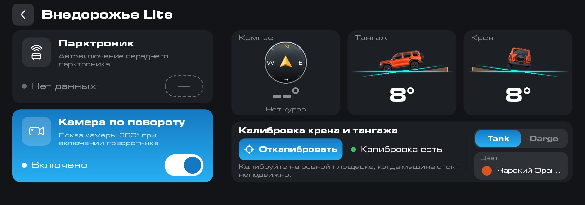
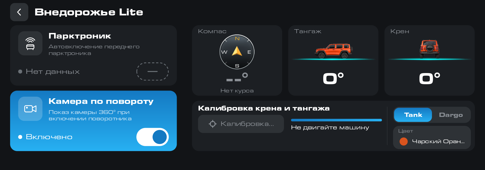
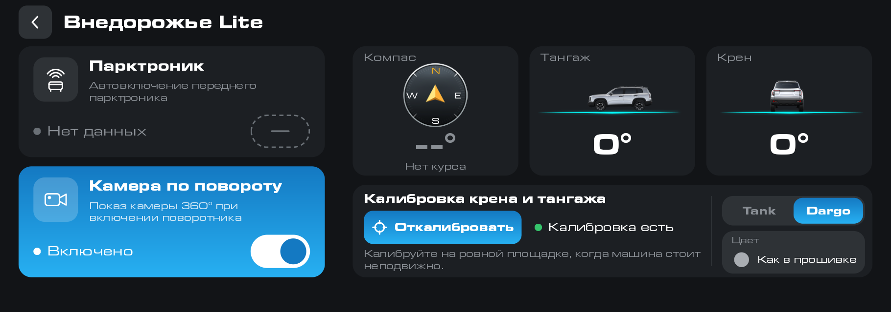

# Внедорожье Lite

> Приложение бесплатно. Если оно пригодилось, можно [поблагодарить автора](https://pay.cloudtips.ru/p/1e6ed2bf).

Окно для ГУ Tank 300 и Haval Dargo: две кнопки для парктроника и камеры, компас, тангаж и крен. Работает на штатной прошивке, где виджет [«Внедорожья»](../offroad/README.md) не поставить.

За городом парктроник пищит даже на траву, а камера включается сама. Отключить то и другое можно в настройках ГУ, но заходить туда каждый раз неудобно. Здесь это одно нажатие.

Снимки с эмулятора. Тангаж и крен подставные. Курса на эмуляторе нет, поэтому компас показывает «--°», настоящий курс бывает только на ГУ. Службы камеры Aptiv на эмуляторе нет, поэтому состояние кнопок не настоящее.

- «Парктроник» включает и выключает автовключение переднего парктроника.
- «Камера по повороту» включает и выключает показ камеры 360° при включении поворотника. Та же настройка включает камеру и при простом повороте руля.
- «Компас» показывает курс по GPS и сторону света. Магнитного компаса в машине нет, курс берётся из GPS, поэтому стоя на месте он неизвестен и компас показывает «--°». Без сигнала GPS компас тоже бесполезен. Курс показывается при скорости не ниже 1 м/с.
- «Тангаж» показывает подъём или спуск, «Крен» наклон вбок. Оба считаются по акселерометру и нуждаются в калибровке. Картинки машины и компас такие же, как в виджете [«Внедорожья»](../offroad/README.md).

Кнопки переключают те же настройки, что раздел «Автомобиль → Парковка» штатной прошивки.

## Калибровка

Откалибровать тангаж и крен нужно один раз, на ровной площадке, при стоящей машине: нажмите «Откалибровать». Приложение усредняет показания за две секунды. Если машина двигалась, калибровку оно не примет и напишет «Машина не стояла». Нулём станет тот наклон, который был при калибровке. Без калибровки тангаж и крен показываются как «--°».

Направление наклона и силуэт зависят от машины. На Tank 300 знак прямой, на Dargo обратный. В карточке калибровки стоит переключатель «Tank» и «Dargo»: начальное значение ставит модель машины, ручной выбор запоминается. Под ним поле «Цвет» открывает цвета выбранной модели (у Tank пять, у Dargo девять), «как в прошивке» возвращается при смене модели.

| Идёт калибровка | Модель Dargo |
|---|---|
|  |  |

На правом снимке выбрана модель Dargo: силуэты другие, цвет «как в прошивке».

Датчики включены, только пока окно открыто. Своей службы у приложения нет, в фоне оно ничего не читает. Тема только тёмная.

## Установка

1. Скачайте APK актуальной версии из раздела [Версии](#версии).
2. Поставьте его тем способом, которым вы ставите приложения на своё ГУ. Как поставить приложение без модифицированной прошивки и DSp, описано [в инструкции](../INSTALL.md), а на прошивке GWM-club — [в этой](../INSTALL-CLUB.md).
3. Откройте «Внедорожье Lite» на экране приложений.

## Совместимость

Версия 0.1 проверена на Tank 300 City с прошивкой GWM-club и на Haval Dargo со штатной прошивкой: компас, тангаж, крен, калибровка и обе кнопки работают. Версия 0.1.2 проверена на Tank 300 City с прошивкой GWM-club. В 0.1.2 картинки наклона на Dargo были перевёрнуты, в 0.1.3 это исправлено по самим картинкам и штатному виджету, на машине исправление ещё не проверялось. Tank 300 Part Time не проверялся.

## Версии

<!-- versions -->
Актуальная версия — **0.1.3** от 07.11.2026: [offroad-lite-0.1.3.apk](https://github.com/theKomix/gwm-apps/releases/download/offroad-lite-v0.1.3/offroad-lite-0.1.3.apk), [описание релиза](https://github.com/theKomix/gwm-apps/releases/tag/offroad-lite-v0.1.3).

- На Dargo картинки тангажа и крена были перевёрнуты: наклон вперёд показывался как наклон назад, наклон вправо как наклон влево. Теперь рисунок выбирается по знаку так же, как в виджете «Внедорожья». У Tank силуэт поворачивается по самому углу, там ошибки не было.

Предыдущие версии:

0.1.2 от 05.11.2026

- Компас и картинки машины такие же, как в виджете «Внедорожья» 2×1: компас с неподвижной стрелкой и силуэты. Для Tank силуэт поворачивается вокруг оси, для Dargo три картинки наклона. Знаков «+» и «−» и подписей «Подъём» и «Правый борт ниже» больше нет, числа без знака.
- Приложение учитывает модель машины. В карточке калибровки вместо выключателя «Перевернуть наклон» стоит переключатель «Tank» и «Dargo». Начальное значение ставит модель машины, выбор запоминается. У Dargo знак датчика обратный, у Tank прямой.
- Под переключателем есть поле «Цвет». По нажатию открывается окно с цветами выбранной модели: у Tank пять, у Dargo девять. Смена модели возвращает цвет «как в прошивке».
- Курс считается и по двум последним точкам, если приёмник отдаёт нулевой курс. Курс показывается только при скорости не ниже 1 м/с.

[offroad-lite-0.1.2.apk](https://github.com/theKomix/gwm-apps/releases/download/offroad-lite-v0.1.2/offroad-lite-0.1.2.apk), [описание релиза](https://github.com/theKomix/gwm-apps/releases/tag/offroad-lite-v0.1.2).

0.1.1 от 30.10.2026

- Направление тангажа и крена зависит от машины. На Tank 300 знак прямой, на Dargo обратный, а в 0.1 он был обратным у всех. В карточке калибровки появился выключатель «Перевернуть наклон» («Для Dargo»). Начальное значение ставит модель машины, ручной выбор запоминается.
- Окно приложения на GWM-club уже экрана: слева боковая рейка, сверху строка состояния, и правый край обрезался. Теперь экран уменьшается по ширине окна.

[offroad-lite-0.1.1.apk](https://github.com/theKomix/gwm-apps/releases/download/offroad-lite-v0.1.1/offroad-lite-0.1.1.apk), [описание релиза](https://github.com/theKomix/gwm-apps/releases/tag/offroad-lite-v0.1.1).

0.1 от 29.10.2026

- Компас показывает курс по GPS и сторону света. Стоя на месте GPS курса не даёт, тогда вместо него «--°».
- Тангаж (подъём и спуск) и крен считаются по акселерометру. Экран совпадает с наклоном машины. Нужна калибровка: на ровной площадке, при стоящей машине, кнопкой «Откалибровать». Если машина двигалась, приложение калибровку не принимает.
- Две кнопки переключают те же настройки, что экран «Автомобиль → Парковка» штатной прошивки: автовключение переднего парктроника и показ камеры по повороту.
- Кнопки слева, под рукой водителя. Компас, тангаж, крен и калибровка справа.
- Датчики включены, только пока окно открыто. Своей службы нет, в фоне приложение ничего не читает.
- Тема только тёмная.

[offroad-lite-0.1.apk](https://github.com/theKomix/gwm-apps/releases/download/offroad-lite-v0.1/offroad-lite-0.1.apk), [описание релиза](https://github.com/theKomix/gwm-apps/releases/tag/offroad-lite-v0.1).

[Все версии и описания](https://github.com/theKomix/gwm-apps/releases?q=offroad-lite)
<!-- /versions -->

---

Неофициальный проект, не связан с Great Wall Motor и Aptiv. Названия и марки принадлежат их владельцам.

Приложение распространяется «как есть». Оно переключает те же настройки парктроника и камеры, что экран «Автомобиль → Парковка» штатной прошивки. Картинки внутри приложения (компас и силуэты) принадлежат GWM, версия только для личной установки.
