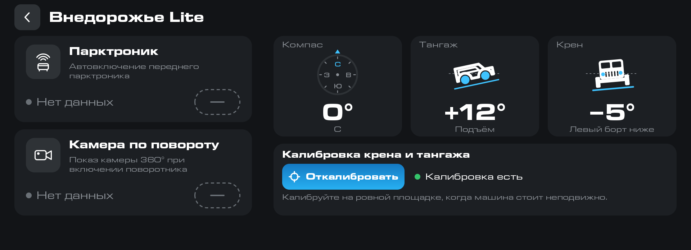
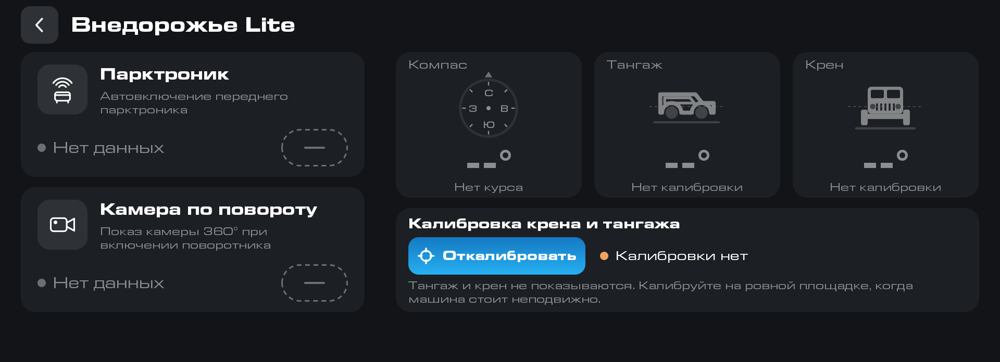
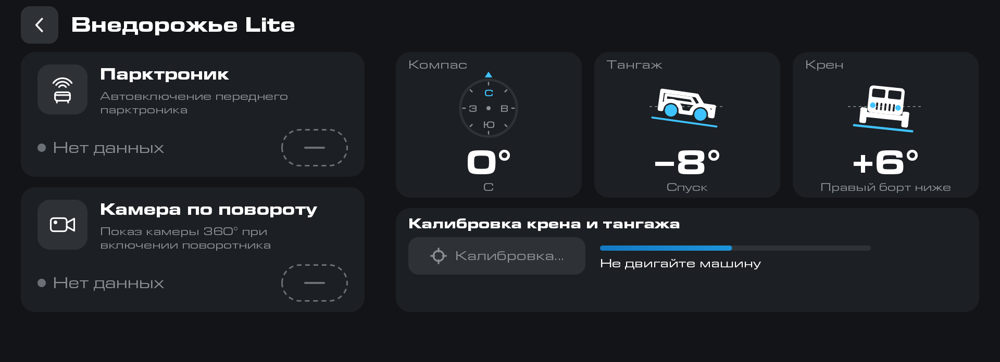

# Внедорожье Lite

> Приложение бесплатно. Если оно пригодилось, можно [поблагодарить автора](https://pay.cloudtips.ru/p/1e6ed2bf).

Окно для ГУ Tank 300 и Haval Dargo: две кнопки для парктроника и камеры, компас, тангаж и крен. Работает на штатной прошивке, где виджет [«Внедорожья»](../offroad/README.md) не поставить.

За городом парктроник пищит даже на траву, а камера включается сама. Отключить то и другое можно в настройках ГУ, но заходить туда каждый раз неудобно. Здесь это одно нажатие.

Снимки с эмулятора. Тангаж и крен подставные. Компас показывает 0° С: курс GPS эмулятора всегда нулевой, настоящий курс есть только на ГУ. Службы камеры на эмуляторе нет, поэтому кнопки показывают «Нет данных».

- «Парктроник» включает и выключает автовключение переднего парктроника.
- «Камера по повороту» включает и выключает показ камеры 360° при включении поворотника. Та же настройка включает камеру и при простом повороте руля.
- «Компас» показывает курс по GPS и сторону света. Магнитного компаса в машине нет, курс берётся из GPS, поэтому стоя на месте он неизвестен и компас показывает «--°». Без сигнала GPS компас тоже бесполезен.
- «Тангаж» показывает подъём или спуск, «Крен» наклон вбок. Оба считаются по акселерометру и нуждаются в калибровке.

Кнопки переключают те же настройки, что раздел «Автомобиль → Парковка» штатной прошивки.

## Калибровка

Откалибровать тангаж и крен нужно один раз, на ровной площадке, при стоящей машине: нажмите «Откалибровать». Приложение усредняет показания за две секунды. Если машина двигалась, калибровку оно не примет и напишет «Машина не стояла». Нулём станет тот наклон, который был при калибровке. Без калибровки тангаж и крен показываются как «--°».

| Нет курса и калибровки | Идёт калибровка |
|---|---|
|  |  |

Датчики включены, только пока окно открыто. Своей службы у приложения нет, в фоне оно ничего не читает. Тема только тёмная.

## Установка

1. Скачайте APK актуальной версии из раздела [Версии](#версии).
2. Поставьте его тем способом, которым вы ставите приложения на своё ГУ. Как поставить приложение без модифицированной прошивки и DSp, описано [в инструкции](../INSTALL.md), а на прошивке GWM-club — [в этой](../INSTALL-CLUB.md).
3. Откройте «Внедорожье Lite» на экране приложений.

## Совместимость

Проверено на Tank 300 City с прошивкой GWM-club и на Haval Dargo со штатной прошивкой: компас, тангаж, крен, калибровка и обе кнопки работают. Tank 300 Part Time не проверялся. На плитке крена нарисован силуэт Tank 300, на Dargo он будет выглядеть иначе.

## Версии

<!-- versions -->
Актуальная версия — **0.1** от 29.10.2026: [offroad-lite-0.1.apk](https://github.com/theKomix/gwm-apps/releases/download/offroad-lite-v0.1/offroad-lite-0.1.apk), [описание релиза](https://github.com/theKomix/gwm-apps/releases/tag/offroad-lite-v0.1).

- Компас показывает курс по GPS и сторону света. Стоя на месте GPS курса не даёт, тогда вместо него «--°».
- Тангаж (подъём и спуск) и крен считаются по акселерометру. Экран совпадает с наклоном машины. Нужна калибровка: на ровной площадке, при стоящей машине, кнопкой «Откалибровать». Если машина двигалась, приложение калибровку не принимает.
- Две кнопки переключают те же настройки, что экран «Автомобиль → Парковка» штатной прошивки: автовключение переднего парктроника и показ камеры по повороту.
- Кнопки слева, под рукой водителя. Компас, тангаж, крен и калибровка справа.
- Датчики включены, только пока окно открыто. Своей службы нет, в фоне приложение ничего не читает.
- Тема только тёмная.

[Все версии и описания](https://github.com/theKomix/gwm-apps/releases?q=offroad-lite)
<!-- /versions -->

---

Неофициальный проект, не связан с Great Wall Motor и Aptiv. Названия и марки принадлежат их владельцам.

Приложение распространяется «как есть». Оно переключает те же настройки парктроника и камеры, что экран «Автомобиль → Парковка» штатной прошивки.
