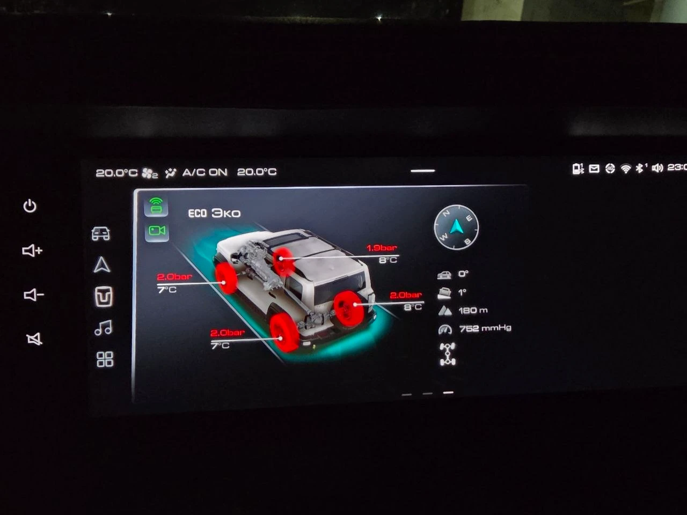

# Внедорожье

> Приложение бесплатно. Если оно пригодилось, можно [поблагодарить автора](https://pay.cloudtips.ru/p/1e6ed2bf).

Виджет для ГУ Tank 300 на прошивке GWM-club: копия штатного виджета «Внедорожные режимы» с двумя кнопками. Кнопки быстро включают и выключают автовключение переднего парктроника и показ камеры при включении поворотника.

За городом парктроник пищит даже на траву, а камера включается сама. Отключить то и другое можно в настройках ГУ, но заходить туда каждый раз неудобно. Виджет делает это одним нажатием прямо с рабочего стола.

- «Парктроник» включает и выключает автовключение переднего парктроника.
- «Камера» включает и выключает показ камеры 360° при включении поворотника. Та же настройка включает камеру и при простом повороте руля.
- Остальное как в штатном виджете: давление и температура шин, режим движения, схема осей и блокировок, давление воздуха. Низкое давление подсвечивает красным все четыре колеса, включённая задняя блокировка горит зелёным.
- Картинка машины выбирается по конфигурации ГУ. Цвет кузова меняется в настройках приложения.
- Курс, тангаж и крен виджет получает от приложения Premium, которое есть в прошивке GWM-club. Без него эти показания выводит [«Внедорожье Lite»](../offroad-lite/README.md).

Кнопки стоят столбиком у левого края в размерах 1×1, 1×2 и 2×2, а в размере 2×1 в ряд. Пока служба камеры не ответила, выключенное состояние рисуется как «нет данных».

## Для какой прошивки

Для прошивки GWM-club. В лаунчере штатной прошивки есть ограничение: он показывает только штатные виджеты, и «Внедорожье» на рабочий стол там не поставить. Для штатной прошивки есть [«Внедорожье Lite»](../offroad-lite/README.md), оно работает в отдельном окне.

## Установка

1. Скачайте APK актуальной версии из раздела [Версии](#версии).
2. Поставьте его на ГУ по [инструкции для GWM-club](../INSTALL-CLUB.md).
3. Добавьте виджет «Внедорожье» на рабочий стол. Если его нет в списке, перезагрузите ГУ. Настройки открываются значком «Внедорожье» на экране приложений.

Связь с машиной устанавливается через 10–15 секунд после запуска службы, до этого виджет показывает нули.

## Совместимость

Проверено на Tank 300 City с прошивкой GWM-club в режиме «ЭКО», самый большой виджет: связь с машиной, шины, режим движения, подсветка колёс, задняя блокировка, кнопки. Режим «Стандарт» смотрели на другом Tank 300 по фото: данные и настройки в порядке. На других комплектациях виджет может выглядеть иначе. Tank 300 Part Time и Haval Dargo не проверялись, передняя блокировка тоже. Если на вашей машине виджет работает криво, пришлите автору фото штатного виджета и «Внедорожья»: держать их на рабочем столе можно одновременно.

## Версии

<!-- versions -->
Актуальная версия — **0.1.2** от 29.10.2026: [offroad-0.1.2.apk](https://github.com/theKomix/gwm-apps/releases/download/offroad-v0.1.2/offroad-0.1.2.apk), [описание релиза](https://github.com/theKomix/gwm-apps/releases/tag/offroad-v0.1.2).

- В малом виджете 1×1 колёса теперь поворачиваются вслед за рулём. Раньше виджет не перерисовывался, когда картинка менялась.
- Компас рисуется жёлтым, как в теме ГУ, а не синим. Картинки макетов виджет теперь берёт из темы ГУ, как штатный.
- Добавлены права на чтение данных машины (руль, шины и другие), чтобы подписка на события не отказывала молча.

Предыдущие версии:

0.1.1 от 29.10.2026

[offroad-0.1.1.apk](https://github.com/theKomix/gwm-apps/releases/download/offroad-v0.1.1/offroad-0.1.1.apk), [описание релиза](https://github.com/theKomix/gwm-apps/releases/tag/offroad-v0.1.1).

0.1 от 29.10.2026

- Виджет показывает данные машины как штатный: давление и температуру шин, режим движения, схему осей и блокировок, давление воздуха. Низкое давление подсвечивает красным все четыре колеса.
- Включённая задняя блокировка дифференциала горит зелёным на схеме осей.
- Картинка машины выбирается по конфигурации ГУ. Цвет кузова меняется в настройках.
- Курс, тангаж и крен виджет получает от приложения Premium прошивки GWM-club. Без него эти показания выводит «Внедорожье Lite».
- Две кнопки стоят столбиком у левого края, правее наклонной рамки лаунчера, в размерах 1×1, 1×2 и 2×2. В размере 2×1 они стоят в ряд. Пока служба камеры не ответила, «выключено» рисуется как «нет данных».
- Связь с машиной устанавливается через 10–15 секунд после запуска службы, до этого виджет показывает нули.
- Настройки: индикаторы, модель машины и цвет кузова на одном тёмном экране.

[offroad-0.1.apk](https://github.com/theKomix/gwm-apps/releases/download/offroad-v0.1/offroad-0.1.apk), [описание релиза](https://github.com/theKomix/gwm-apps/releases/tag/offroad-v0.1).

[Все версии и описания](https://github.com/theKomix/gwm-apps/releases?q=offroad)
<!-- /versions -->

---

Неофициальный проект, не связан с Great Wall Motor и Aptiv. Названия и марки принадлежат их владельцам.

Приложение распространяется «как есть». Оно переключает те же настройки парктроника и камеры, что экран «Автомобиль → Парковка» штатной прошивки. Картинки и макеты внутри приложения принадлежат GWM, версия только для личной установки.
