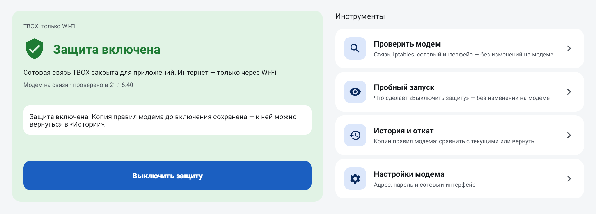
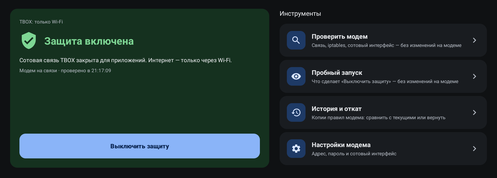
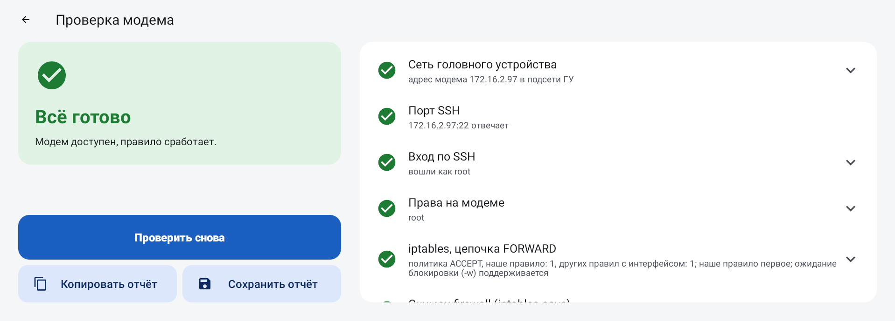
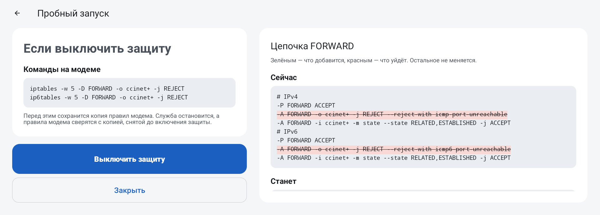
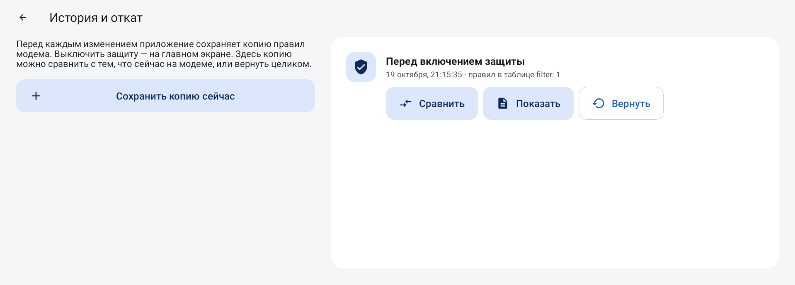
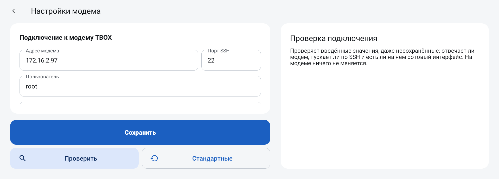

# TBOX: только Wi-Fi

Интернет для приложений на ГУ — только через Wi-Fi, трафик сим-карты TBOX они не тратят.

Когда Wi-Fi нет, приложения на ГУ выходят в интернет через встроенный модем TBOX и расходуют
трафик его сим-карты. «TBOX: только Wi-Fi» ставит на модеме правило, которое не пускает трафик
приложений ГУ в сотовую сеть. Штатные функции TBOX продолжают работать, само ГУ оно не меняет.

<table>
  <tr>
    <td></td>
    <td></td>
  </tr>
</table>

## Что умеет

- Защита включается и выключается одной кнопкой. Выключение и есть откат: приложение снимает
  своё правило и сверяет правила модема с копией, снятой до включения.
- Перед включением приложение проверяет модем: связь, вход, права, сотовый интерфейс. На модеме
  при проверке ничего не меняется.
- Пробный запуск показывает, какие команды выполнятся и как изменятся правила модема, ничего
  не применяя.
- Перед каждой правкой приложение сохраняет копию правил модема. Копию можно сравнить
  с текущими правилами или вернуть целиком.
- Правило живёт в памяти модема и пропадает после его перезапуска. Приложение работает в фоне,
  следит за правилом и ставит его снова.
- IPv6 закрывается тоже, если модем это поддерживает; если нет, приложение предупреждает.
- Есть дневная и ночная темы.

<table>
  <tr>
    <td></td>
    <td></td>
  </tr>
  <tr>
    <td></td>
    <td></td>
  </tr>
</table>

## Совместимость

Проверено на Tank 300. На Haval Dargo приложение должно работать, но там его не проверяли.

Нужен Android 9 или новее и доступ с ГУ к модему TBOX по SSH. Подписанная тестовыми ключами
прошивка этому приложению не нужна.

## Установка

1. Скачайте `gwm-tbox-rules-v<версия>.apk` из раздела
   [Releases](https://github.com/theKomix/gwm-apps/releases).
2. Поставьте его тем способом, которым вы ставите приложения на своё ГУ. Как поставить
   приложение без модифицированной прошивки и DSp, описано
   [в инструкции](../INSTALL.md).
3. Откройте «TBOX: только Wi-Fi», нажмите «Проверить модем», а затем «Включить защиту».

Новая версия ставится поверх старой, настройки сохраняются.

## Настройки модема

Заводские значения уже подставлены: адрес `172.16.2.97`, порт `22`, пользователь `root` и
заводской пароль модема. С ними приложение подключается сразу после установки.

Если пароль на модеме меняли, введите свой в «Настройках модема». Кнопка «Стандартные»
возвращает заводские значения. Перед сохранением нажмите «Проверить»: проверяются введённые
значения, а на модеме ничего не меняется.

## Поддержать

Если приложение пригодилось, можно [поблагодарить автора](https://pay.cloudtips.ru/p/1e6ed2bf).

---

Приложение распространяется «как есть». Оно меняет правила firewall на модеме TBOX: перед
каждой правкой сохраняет их копию, а выключение защиты снимает его правило.
